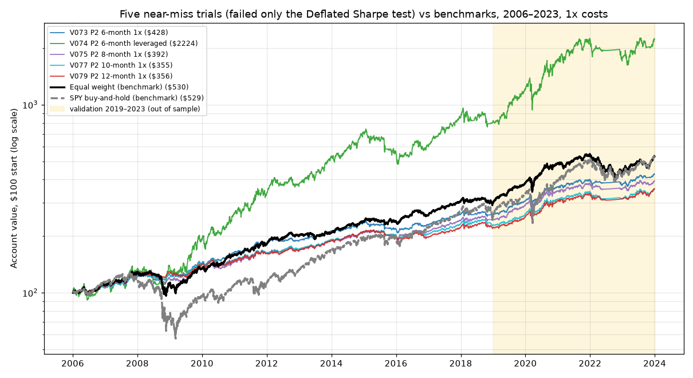

# Can a $100 account reach $1,000 with simple ETF or commodity strategies?

**Two pre-registered backtest studies of end-of-day strategies (2004–2023): 92 on gold, S&P 500, Nasdaq-100 and long Treasury ETFs and their 2x/3x leveraged versions, then 26 on gold, silver and oil.**

**Headline: 0 of 118 pre-registered strategies survived** (the Deflated Sharpe test used the cumulative N = 118). Some killed trials and QQQ buy-and-hold had higher 2019–2023 Sharpe ratios than a 70/30 SPY/GLD mix (best: 0.99 vs 0.82), but none by enough to rule out luck. The 70/30 SPY/GLD mix (Sharpe 0.82, worst drop −25%) beat every commodity trial and is a sensible no-skill baseline.

**Study 1 (ETFs): 0 of 92 survived.** Some beat a simple equal-weight portfolio out of sample (2019–2023), but none by enough to rule out luck from testing 92 variants: the best Deflated Sharpe probability was 0.73, against 0.95 required. Nothing tested beat a low-cost diversified index portfolio once overfitting was accounted for. For a $100 account, saving $100 a month reaches $1,000 in 9 months; no strategy here was a faster or more reliable route.

**Study 2 (commodities): 0 of 26 survived.** Best Deflated Sharpe 0.43 at N = 118, against 0.95 required. See [Study 2: Commodities](#study-2-commodities) below.

**Read the full write-up: [`reports/FINAL_REPORT.md`](reports/FINAL_REPORT.md)**



## Why this project is set up the way it is
The goal was to answer the question honestly, not to produce a good-looking backtest. That meant:

| Practice | How it was applied |
|---|---|
| Pre-registration | The strategy list and parameter grids were frozen in `research_log.csv` before any backtest ran (V001–V092; Study 2: V093–V118, committed separately before its first run) |
| Clean data splits | In-sample 2006–2018 for tuning, validation 2019–2023 for selection, holdout 2024+ never opened or downloaded |
| Overfitting control | Walk-forward analysis, bootstrap confidence intervals, and the Deflated Sharpe Ratio with N = 92, then cumulative N = 118 |
| Mechanical decisions | 7 kill criteria agreed before results were seen; applied by script, none changed afterwards |
| Full logging | Every run, including every failure, is a row in `research_log.csv` (1,001 rows) |
| Tested code | 63 unit tests covering no lookahead, cost arithmetic, cash interest, adjusted prices, the risk-mode switch, the synthetic-leverage formula, the Monte Carlo, and FRED release lags |
| Honest reporting | Errors I made along the way are recorded in `PROGRESS.md` (e.g. a sanity-check claim corrected before review) |

## Repository map
| Path | Contents |
|---|---|
| [`reports/FINAL_REPORT.md`](reports/FINAL_REPORT.md) | Verdict, method, results, limitations, next steps |
| [`reports/kill_table.md`](reports/kill_table.md) | Pass/fail and reasons for all 92 trials |
| [`reports/phase5_validation.md`](reports/phase5_validation.md) | Full out-of-sample metrics, walk-forward, stress tests, heatmaps |
| [`reports/data_quality.md`](reports/data_quality.md) | Data validation and synthetic leveraged series |
| [`reports/INFORMATIONAL_phase7a_monte_carlo.md`](reports/INFORMATIONAL_phase7a_monte_carlo.md) | Odds of $100 → $1,000 (not validated, failed DSR) |
| [`research/LITERATURE_REVIEW.md`](research/LITERATURE_REVIEW.md), [`research/sources.csv`](research/sources.csv) | 49 sources that shaped the strategy list |
| [`reports/commodities_kill_table.md`](reports/commodities_kill_table.md), [`reports/commodities_phase5_validation.md`](reports/commodities_phase5_validation.md) | Study 2 kill table and validation |
| [`research/IDEA_POOL_COMMODITIES.md`](research/IDEA_POOL_COMMODITIES.md), [`research/sources_commodities.csv`](research/sources_commodities.csv) | Study 2: 153 graded sources, ranked ideas, $100 instrument feasibility |
| [`reports/data_quality_commodities.md`](reports/data_quality_commodities.md) | Study 2 data validation |
| [`AUDIT.md`](AUDIT.md) | Security audit of a third-party trading repo (only one function reused, with MIT attribution) |
| `config.yaml` | Every parameter: instruments, dates, costs, taxes, risk modes, seed, frozen strategy list |
| `src/` | `data` (download, validation, synthetic leverage), `engine` (backtester), `strategies`, `metrics`, `validate` (walk-forward, bootstrap, DSR, Monte Carlo), `risk` |
| `tools/` | One runner per phase and the report generators |
| `tests/` | Unit tests (`pytest`) |
| `PROGRESS.md` | Phase-by-phase decision log |

## Reproduce
Python 3.10+ (built on 3.14.8).

```bash
python3 -m venv .venv
.venv/bin/pip install -r requirements.txt
.venv/bin/python -m pytest -q tests
```

To rebuild from scratch (downloads stop at 2023-12-31 while the holdout is locked):

```bash
.venv/bin/python -c "from src.data import download_all, build_clean; download_all(); build_clean()"
```

Then run in order: `tools/sanity_in_sample.py`, `tools/run_in_sample.py`, `tools/run_phase5.py`, `tools/make_phase5_report.py`, `tools/run_phase6.py`, `tools/run_info_phase7a.py`. Study 2: `tools/download_commodities.py`, then `.venv/bin/python -c "from src.commodities import build_clean; build_clean()"`, then `tools/run_commodities.py --phase 4`, `--phase 5`, `--phase 6`. Finally `tools/make_final_report.py`. The runners append to `research_log.csv`; the report generators don't.

`requirements.txt` pins the seven packages used; `requirements-lock.txt` pins all transitive dependencies. Downloaded data (`data/`) and intermediate results (`results/`) are not tracked. Download dates and SHA-256 hashes are in `data/raw/download_meta.json`.

## Study 2: Commodities
After Study 1, a research phase graded 153 sources on gold and commodity strategies (114 kept) and ranked the testable ideas. Five were chosen and **26 trials were frozen before any backtest**: momentum basket, volatility-scaled trend, dual momentum, a real-yield filter and a dollar-trend filter, on GLD/SLV/USO and their 2x versions UGL/AGQ/UCO. The engine, costs, data splits and kill criteria were the same as Study 1; the Deflated Sharpe test used the **cumulative N = 118**.

| Criterion (K1–K7) | K1 | K2 | K3 | K4 | K5 | K6 | K7 |
|---|---|---|---|---|---|---|---|
| Trials failing (of 26) | 20 | 26 | 0 | 13 | 18 | 6 | 0 |

| Validation 2019–2023 | Sharpe | CAGR | Max drawdown |
|---|---|---|---|
| Best commodity trial: V108 dual momentum, 6-month, 2x (DSR 0.43) | 0.63 | 23.7% | −66.9% |
| Same rule at 1x (V107) | 0.63 | 18.1% | −41.4% |
| **70/30 SPY/GLD, rebalanced monthly** | **0.82** | 14.4% | −25.2% |
| SPY | 0.72 | 15.8% | −33.7% |
| GLD buy-and-hold | 0.56 | 9.6% | −22.0% |

**Oil dependence.** The best results came from rotating into oil during its 2021–2022 rally: V107 held oil on 93% of 2021 and 66% of 2022 trading days, returned +71% and +43% in those years, then lost 28% in 2023.

**Study 2 limitations:** single data source (Yahoo Finance); USO changed structure in April 2020 (front-month to multi-month futures, 1-for-8 reverse split), so oil results are flagged; FRED signals used today's vintage (release lags modelled, revisions not); AGQ/UCO history before December 2008 is synthetic (validation used real prices only); the 2019–2023 validation window had already been seen for gold in Study 1.

## Scope and rules
- End-of-day signals only; trades fill at the next open; long-only; leverage only through the listed ETFs.
- No orders were ever placed and no brokerage was connected.
- Limitations: single data source (Yahoo Finance); synthetic leveraged history before 2008–2010; a 5-year validation window; and a 2019–2023 regime that favored US tech and punished long bonds. See section 5 of the final report, and Study 2 above.

## Credits
- **day-trader-skill** by Jake Schincariol (MIT License), https://github.com/Jakeschincariol/day-trader-skill. This project audited that repository (see [`AUDIT.md`](AUDIT.md)) and reused exactly one function: the Wilder RSI from `trader-scanner/scan.py` (commit `3d0f4ef`). It is used in `src/strategies.py:wilder_rsi`, with one change (a flat series returns 50). The original copyright and permission notice are in [`licenses/day-trader-skill-MIT.txt`](licenses/day-trader-skill-MIT.txt). Nothing else from that repository is installed, imported or redistributed.
- The research behind the strategy list is credited source by source in [`research/sources.csv`](research/sources.csv).

## License
MIT. See [`LICENSE`](LICENSE). Tax rates in `config.yaml` are example defaults (12% federal, 2.75% Ohio); change them for your situation.

Not financial or tax advice.
