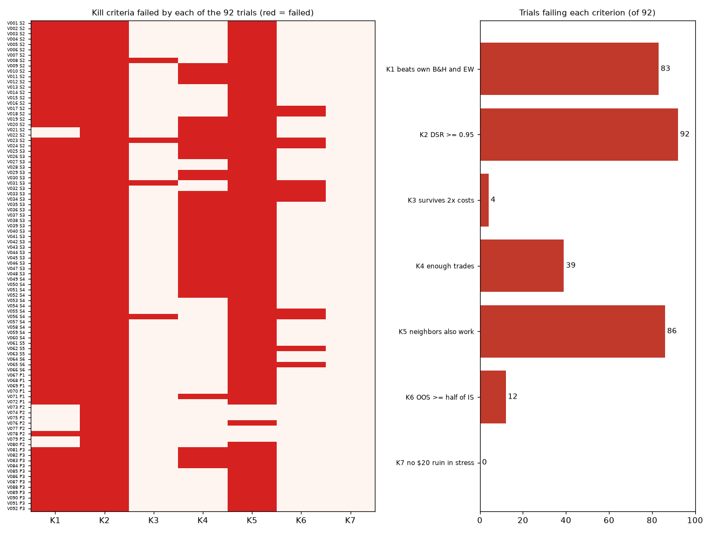

# Can a $100 account reach $1,000 with simple ETF or commodity strategies? Three pre-registered backtest studies

_Final report. Data 2004-11-18 to 2023-12-29. The 2024 onward holdout was never opened. Last updated 2026-10-22._

## Headline (all three studies)

**0 of 134 pre-registered strategies were validated** (Study 1: 92 on ETFs; Study 2: 26 on commodities; Study 3: 16 long-history re-tests; the Deflated Sharpe test used the cumulative N). Over 1927–2018, multi-asset trend rules reduced drawdowns sharply (worst fall about -22% vs -61% for equal weight and -63% for 60/40) but did not add meaningful return over equal weight or 60/40 (8.1% a year vs 7.7% and 8.2%; the difference from equal weight is not statistically significant), and the advantage weakened under higher costs or a one-month signal lag. Two of them (V119 and V122) passed Study 3's primary era rule at 1x costs but failed every pre-registered robustness check. In 2019–2023, some killed trials and QQQ had higher Sharpe ratios than a 70/30 SPY/GLD mix (Sharpe 0.82, worst drop -25%), but none by enough to rule out luck; the 70/30 mix beat every commodity trial and is a sensible no-skill baseline.

## Study 1 verdict: ETFs

**No.** I tested 92 pre-registered end-of-day strategies on gold, S&P 500, Nasdaq-100 and long Treasury ETFs and their 2x/3x leveraged versions, with realistic costs. **None survived the pre-agreed validation rules.** 13 of 92 had a better risk-adjusted return than a simple equal-weight portfolio of the four ETFs in the 2019–2023 out-of-sample period, but the best of them could be explained by luck from testing so many variants. Its Deflated Sharpe probability was 0.73, against the 0.95 required. The closest call, a monthly multi-asset trend filter, had a higher Sharpe ratio than the equal-weight portfolio (0.99 vs 0.81) but a lower return (10.3% vs 12.1% a year), with half the drawdown. That difference is not statistically reliable. Leveraged buy-and-hold raised returns in good years and lost 90%+ in bad ones (UPRO and TQQQ in 2008, TMF in 2020–2023). For a $100 account, monthly savings matter far more than strategy choice: $100 a month reaches $1,000 in 9 months. In the informational simulation, even the best near-miss took a median of about 11 years to get there from $100 alone. **The honest conclusion: nothing tested here beat a low-cost diversified index portfolio once overfitting was accounted for.**

## At a glance

| | |
|---|---|
| Question | Does any aggressive end-of-day strategy on 4 ETFs (+ leveraged versions) have a durable edge after costs? |
| Universe | GLD, SPY, QQQ, TLT; UGL (2x), UPRO, TQQQ, TMF (3x) |
| Data | Daily adjusted OHLC, 2004-11-18 to 2023-12-29 (Yahoo Finance); 3-month T-bill rate for cash |
| Design | 92 variants frozen before any backtest; in-sample 2006–2018, validation 2019–2023, holdout 2024+ (locked) |
| Statistics | Walk-forward, bootstrap confidence intervals, Deflated Sharpe Ratio (N = 92), 7 kill criteria |
| Result | **0 of 92 survive.** 5 near-misses failed only the Deflated Sharpe test |
| Study 2 | Commodities (GLD, SLV, USO; UGL, AGQ, UCO): **0 of 26 survive**; best DSR 0.43 at N = 118 (see Study 2 below) |
| Study 3 | Long history 1927–2018 (stocks, bonds, commodities, gold): P2 trend and S3 momentum re-tested in 4 eras; **0 of 16 validated** (2 pass the era rule at 1x costs only); N = 134 |
| GitHub survey | 20 most-starred trading-strategy repos: 0 show clear out-of-sample results, 0 live results, 2 costs |
| Engineering | Python, pandas/numpy/scipy; 68 unit tests; every run logged (1045 rows in `research_log.csv`) |

## 1. What was tested

**Instruments.** Four unleveraged ETFs (GLD gold, SPY S&P 500, QQQ Nasdaq-100, TLT 20+ year Treasuries) and their leveraged counterparts (UGL 2x gold futures, UPRO/TQQQ/TMF 3x). Leveraged funds launched in 2008–2010. Before that I built synthetic daily series from the underlying ETF, the expense ratio, financing at the T-bill rate, and an extra cost calibrated on 2009–2018 overlap data.

**Strategies** (8 families, 92 variants; grids of 3–4 values, frozen in advance). Signals always come from the unleveraged ETF's close; positions can sit in the leveraged version.

| Family | Rule | Variants |
|---|---|---|
| S2 Trend | Hold when close > N-day moving average (N = 50/100/200), else cash | 24 |
| S3 Time-series momentum | Hold when the trailing 3/6/12-month return > 0 | 24 |
| S4 RSI(2) mean reversion | Buy when RSI(2) < 5/10/15, sell on a close above the 5-day average (SPY/QQQ) | 12 |
| S5 Rotation | Monthly: hold the single best 3/6/12-month performer, cash if all negative | 3 |
| S6 Leveraged rotation | Same as S5, held in the leveraged version | 3 |
| P1 Volatility-gated leverage | Above 200-day average: 3x if 20-day volatility < 15/20/25%, else 1x; below: cash | 6 |
| P2 Multi-asset trend | Monthly: 25% in each ETF above its 6/8/10/12-month average, rest cash | 8 |
| P3 RSI(2) with trend filter | S4 plus close > 200-day average | 12 |

P1–P3 came from a literature review of 49 sources (Gayed & Bilello 2016; Avellaneda & Zhang 2010; Faber 2007; Baltussen et al. 2019). They were approved before any backtest.

**Benchmarks:** buy-and-hold of each of the 8 ETFs, and an equal-weight portfolio of GLD/SPY/QQQ/TLT rebalanced monthly.

## 2. How it was tested

- **No lookahead:** signals use data up to the close; trades fill at the next day's open. A unit test changes future prices and confirms that past signals, trades and equity are unchanged.
- **Costs:** half-spread 0.02% (unleveraged) or 0.05% (leveraged), plus 0.05% slippage, on every fill; $0 commission; fractional shares; $1 minimum order. Uninvested cash earns the T-bill rate. Every result was rerun at 2x and 3x costs.
- **Engine check:** buy-and-hold CAGR and max drawdown from the backtester match a direct pandas calculation to 2 decimals for all 9 benchmarks. A hand-calculated trade matches the engine on every cost line.
- **Splits:** in-sample 2006–2018 (tuning only), validation 2019–2023 (selection only), holdout 2024+ (never opened, never downloaded).
- **Walk-forward:** each year from 2011 to 2023, pick the parameter with the best Sharpe over the prior 5 years and use it the following year.
- **Multiple testing:** the Deflated Sharpe Ratio (Bailey & López de Prado 2014) gives the probability that a strategy's true Sharpe beats the best result expected by chance from 92 trials. Bootstrap 95% confidence intervals use 10,000 resamples with a fixed seed.
- **Kill criteria, applied mechanically.** A strategy dies if it fails any one:
  - K1: it doesn't beat both its own buy-and-hold and equal weight out of sample;
  - K2: Deflated Sharpe probability below 0.95;
  - K3: profitable at 1x costs but not at 2x;
  - K4: fewer than 30 trades (monthly strategies need 5 years of out-of-sample data instead);
  - K5: a neighboring parameter value fails;
  - K6: out-of-sample Sharpe below half of in-sample;
  - K7: $100 falls to $20 in 2008, the 2020 crash or 2022.

## 3. Results

**Full period, in dollars:** from $100 in January 2006, the four 1x near-misses ended 2023 with $355–$428, **less than** buy-and-hold equal weight ($530) or SPY ($529). Their advantage is smoother returns and smaller drawdowns, not more money. The leveraged version (V074) ended with $2224, with a 35% worst drawdown on the way.

**Out of sample (2019–2023):**
- 13 of 92 trials beat equal weight's Sharpe (0.81); 9 also beat buy-and-hold of their own instrument.
- In walk-forward (2011–2023), 1 of 30 strategy groups beat equal weight.
- **No trial reached a Deflated Sharpe probability of 0.95.**

| Best 5 out of sample | Validation Sharpe | 95% CI | Deflated Sharpe (N=92) | Validation CAGR | Max drawdown |
|---|---|---|---|---|---|
| V073 P2 sma_months=6 | 0.99 | [0.13, 1.92] | 0.73 | 10.3% | -11.6% |
| V079 P2 sma_months=12 | 0.96 | [0.06, 1.86] | 0.70 | 9.9% | -11.5% |
| V075 P2 sma_months=8 | 0.93 | [0.05, 1.84] | 0.68 | 9.8% | -11.5% |
| V074 P2 sma_months=6 | 0.91 | [0.00, 1.82] | 0.67 | 22.4% | -32.5% |
| V021 S2 N=200 | 0.90 | [0.02, 1.81] | 0.66 | 17.6% | -23.3% |
| Equal weight (benchmark) | 0.81 | | | 12.0% | -25.6% |
| SPY (benchmark) | 0.72 | | | 15.8% | -33.7% |

### Kill table

| Criterion | Trials failing |
|---|---|
| K1 beats own B&H and EW | 83 |
| K2 DSR >= 0.95 | 92 |
| K3 survives 2x costs | 4 |
| K4 enough trades | 39 |
| K5 neighbors also work | 86 |
| K6 OOS >= half of IS | 12 |
| K7 no $20 ruin in stress | 0 |

Full per-trial reasons: [`kill_table.md`](kill_table.md).

### Why everything failed

1. **The required edge was too large for the data.** Five years of daily returns give a Sharpe ratio a standard error of roughly ±0.45. With 92 trials, the best result expected from pure noise is a Sharpe of about 0.71. The best real result (0.99) clears that, but not by enough to be 95% confident.
2. **Single-ETF timing rules mostly reduce risk; they don't add return.** Trend filters on one ETF usually lagged buy-and-hold on Sharpe (S2 median in-sample Sharpe 0.26 vs SPY 0.42), consistent with the academic literature (Zakamulin 2015; Huang et al. 2020).
3. **Results were fragile.** 86 of 92 trials also failed the neighbor test: a nearby parameter value didn't hold up out of sample. The edge, where it appeared, depended on the exact setting.
4. **Costs hurt the active strategies.** The RSI(2) family turns its account over 11–32 times a year; at 3x costs its Sharpe fell by up to 0.41.
5. **Diversification was the hidden winner.** The equal-weight portfolio of four uncorrelated-ish assets had a Sharpe of 0.81, higher than SPY's 0.72, with no rules at all. The near-miss P2 strategies are essentially that portfolio plus a trend filter.

## 4. Informational Monte Carlo — NOT VALIDATED, FAILED DSR

> Every strategy below was **killed**. This section answers "what if?" for illustration only. It replays 2019–2023 daily returns in random 20-day blocks (10,000 paths, 30-year horizon). It assumes the future looks like a strong stock market. Not a recommendation.

Chance that $100 reaches $1,000 before falling to $20, and median years to $1,000 (no monthly additions):

| Series | 20% invested | 50% invested | 100% invested |
|---|---|---|---|
| V073 P2 6-month 1x | 0%, over 30 yrs | 1%, over 30 yrs | 94%, 23 yrs |
| V074 P2 6-month leveraged | 2%, over 30 yrs | 98%, 19 yrs | 100%, 11 yrs |
| Equal weight (benchmark) | 0%, over 30 yrs | 28%, over 30 yrs | 95%, 20 yrs |
| SPY buy-and-hold (benchmark) | 0%, over 30 yrs | 78%, 26 yrs | 98%, 15 yrs |
| UPRO buy-and-hold (benchmark) | 85%, 23 yrs | 98%, 11 yrs; 1% hit $20 first | 82%, 7 yrs; 18% hit $20 first |

With **$50 or $100 added per month**, every series reaches $1,000 in roughly 0.7–1.4 years, mainly because of the deposits. Details: [`INFORMATIONAL_phase7a_monte_carlo.md`](INFORMATIONAL_phase7a_monte_carlo.md).

## 5. Limitations

- **Single data source.** All prices come from Yahoo Finance via yfinance (downloaded 2026-10-22). The planned cross-check against Stooq was impossible: its download now sits behind a bot-verification page. Two suspected stale-price stretches (QQQ Aug 27–29 2012; UGL May 18–22 2018) remain unresolved. Rerunning all 92 trials with those days interpolated changed no conclusion (in-sample Sharpe moved by at most 0.016; validation not at all).
- **Synthetic leveraged history before 2008–2010.** UGL, UPRO, TQQQ and TMF did not exist in 2004–2008, so their pre-launch history, including the 2008 crash, is modelled. After calibration the synthetic series track the real funds closely (correlation 0.996–0.999). In 2019–2023 they still differed by about a point a year: UGL optimistic (+1.5 pp/yr); UPRO optimistic (+1.2 pp/yr); TQQQ optimistic (+1.0 pp/yr); TMF pessimistic (-0.7 pp/yr). UGL tracks gold futures, not GLD, adding further tracking error.
- **Short validation window.** Five years (2019–2023) is too short to separate a modest edge from luck. That is the main reason the Deflated Sharpe test failed.
- **2019–2023 regime bias.** The validation period was strong for US large-cap tech (QQQ Sharpe 0.86) and historically bad for long Treasuries (TMF −18%/year, −92% drawdown). Rules that favored equities and avoided bonds look better than they likely are in general.
- **Model simplifications:** today's expense ratios applied to all history; fills at the open with fixed cost assumptions (no market impact; leveraged ETFs can gap more than 33% in a day); the Monte Carlo's constant position sizing ignores rebalancing costs. Taxes were not computed, because no strategy survived. If revisited: short-term gains are taxed as ordinary income (example rates in `config.yaml`: 12% federal + 2.75% Ohio; change for your situation), and **UGL issues a K-1** (commodity pool; futures gains roughly 60% long-term / 40% short-term).
- **The holdout (2024 onward) was deliberately left unopened.** It remains a clean test set for a future, separately pre-registered study.

## 6. What a future study would need to do differently

1. **Test far fewer ideas, chosen more carefully.** The Deflated Sharpe hurdle grows with the number of trials. A study of 5–10 variants motivated by economics would need a much smaller edge to pass.
2. **Use longer out-of-sample evidence.** Use futures or index data back to the 1970s (or earlier) for the underlying markets, so validation spans several regimes, including inflation-driven bond bear markets.
3. **Diversify across many markets, not 4 ETFs.** The trend-following evidence that holds up (e.g. Hurst, Ooi & Pedersen 2017) comes from 50+ futures markets with volatility scaling, not single-asset timing.
4. **Get a second, independent data source** (e.g. issuer NAV histories or a licensed vendor) and resolve data anomalies before testing.
5. **Pre-register the holdout test now:** if a new, independently motivated strategy is defined, run it once on 2024 onward and accept the result.
6. **Treat contributions as the main lever for small accounts.** At $100, saving rate and diversification dominate any timing rule tested here.

## Study 2: Commodities

**Question.** After Study 1, does an evidence-backed end-of-day strategy on gold, silver or oil do better? The research phase graded 153 sources (114 kept; `research/sources_commodities.csv`) into a ranked idea pool (`research/IDEA_POOL_COMMODITIES.md`). Five ideas were chosen and **26 trials were frozen (V093–V118) before any backtest**; the Deflated Sharpe test used the **cumulative N = 118** (92 + 26). Same engine, costs, splits (in-sample 2007-07-02 to 2018, validation 2019–2023, holdout locked) and kill criteria K1–K7, unchanged. Copper was dropped (CPER unusable before 2017).

| Idea | Rule | Trials |
|---|---|---|
| I01 Momentum basket | Month-end: 1/3 each in GLD/SLV/USO whose 3/6/12-month return beats T-bills; 1x or 2x | 6 |
| I03 Volatility-scaled trend | Carver EWMAC(16,64), sized to 15/20/25% target volatility, weekly; gold only or basket | 6 |
| I04 Dual momentum | Month-end: hold the best 3/6/12-month performer of GLD/SLV/USO if it beats T-bills; 1x or 2x | 6 |
| I05 Real-yield filter | Hold GLD/UGL when the 20-day average 10-year TIPS yield is below its 120/250-day average | 4 |
| I06 Dollar-trend filter | Hold GLD/UGL when the broad dollar index is below its 100/200-day average | 4 |

FRED signals used only values already published on each date (TIPS yield from the 2nd trading day after; dollar index from the Wednesday after its week). Benchmarks (not trials): buy-and-hold of each fund, SPY, equal weight GLD/SLV/USO (K1's equal weight) and 70/30 SPY/GLD rebalanced monthly.

### Kill table

**0 of 26 survive.** Best Deflated Sharpe at N = 118: **0.430** (V108, I04_dual_momentum), against 0.95 required.

| Criterion | Trials failing |
|---|---|
| K1 does not beat own buy-and-hold and equal weight | 20 |
| K2 Deflated Sharpe (N=118) below 0.95 | 26 |
| K3 profitable at 1x, not at 2x costs | 0 |
| K4 too few OOS trades / years | 13 |
| K5 edge gone one grid step away | 18 |
| K6 OOS Sharpe below half of in-sample | 6 |
| K7 fell to $20 in a stress period | 0 |

Full table: [`commodities_kill_table.md`](commodities_kill_table.md). Validation detail, walk-forward and stress tests: [`commodities_phase5_validation.md`](commodities_phase5_validation.md).

### Compared with the 70/30 SPY/GLD benchmark (validation 2019–2023)

| Series | Sharpe | CAGR | Max drawdown |
|---|---|---|---|
| V108 I04_dual_momentum (best DSR) | 0.63 | 23.7% | -66.9% |
| V107 same rule at 1x | 0.63 | 18.1% | -41.4% |
| 70/30 SPY/GLD | 0.82 | 14.4% | -25.2% |
| SPY | 0.72 | 15.8% | -33.7% |
| GLD buy-and-hold | 0.56 | 9.6% | -22.0% |
| Equal weight GLD/SLV/USO | 0.42 | 9.0% | -40.7% |

No commodity trial matched the 70/30 mix on a risk-adjusted basis; the best had a higher return only by taking a much deeper drawdown.

### Dependence on oil in 2021–2022

The best commodity results came from rotating into oil during its 2021–2022 rally. Calendar-year returns:

| Series | 2019 | 2020 | 2021 | 2022 | 2023 |
|---|---|---|---|---|---|
| V107 dual momentum 6m, 1x | +4% | +25% | +71% | +43% | -28% |
| V108 same, 2x | +0% | +26% | +157% | +74% | -49% |
| 70/30 SPY/GLD | +28% | +21% | +18% | -13% | +22% |
| USO | +33% | -68% | +65% | +29% | -5% |

V107 and V108 held oil on 93% of 2021 trading days and 66% of 2022 trading days, then lost 28% and 49% in 2023. One commodity rally in a five-year window is exactly the kind of result the Deflated Sharpe test discounts.

### Study 2 limitations

- **Single data source** (Yahoo Finance; the Stooq cross-check is still blocked).
- **USO changed structure in April 2020** (from front-month to a spread of futures months, plus a 1-for-8 reverse split). Oil results before and after come from a differently built fund; every oil result is flagged.
- **FRED revisions not modelled.** Signals used today's FRED vintage, not the values as first published (release lags were modelled; revisions were not).
- **Synthetic 2x history before December 2008.** AGQ and UCO are modelled from SLV and USO before launch, with an extra cost calibrated on 2008–2018 overlap (AGQ 4.3%, UCO 0.9% a year). Validation used real prices only.
- **Same 2019–2023 validation window as Study 1**, so gold ideas were tested again on years already seen for gold.

## Study 3: Long-history validation (1927–2018)

**Question.** Do the closest near-misses hold up over decades, not five years? No new ideas: the P2 multi-asset trend rule (6/8/10/12 months) and S3 time-series momentum (3/6/12 months) were re-tested on monthly data for US stocks (Ken French), long Treasuries (built from FRED yields), commodity futures (AQR) and gold (World Bank, from 1971). **16 trials were frozen before any run (V119–V134); cumulative N = 134.** Costs per trade follow Hurst, Ooi & Pedersen (2017): stocks 0.34%, commodities and gold 0.58% before 1993, falling to 0.07–0.10% after 2003. Pass rule: beat own buy-and-hold and 60/40 on Sharpe in at least 3 of 4 eras.

| ID | Rule | 1927–49 | 1950–79 | 1980–99 | 2000–18 | Eras passed (1x / 2x / 3x costs / 1-month lag) | Full-span CAGR | Worst 10 years | Max drawdown |
|---|---|---|---|---|---|---|---|---|---|
| V119 | P2 trend, 6-month | 0.55 ✓ | 0.93 ✓ | 0.30 | 1.07 ✓ | 3 / 2 / 2 / 1 | 7.9% | +2.3%/yr | -20% |
| V122 | P2 trend, 12-month | 0.57 ✓ | 0.96 ✓ | 0.42 | 0.98 ✓ | 3 / 2 / 2 / 2 | 8.1% | +1.9%/yr | -22% |
| V131 | S3 momentum, stocks, 12-month | 0.47 ✓ | 0.55 ✓ | 0.65 | 0.50 ✓ | 3 / 3 / 2 / 1 | 9.8% | +1.6%/yr | -45% |
| L05 | Equal weight (benchmark) | 0.37 | 0.91 | 0.17 | 0.63 | — | 7.7% | -1.6%/yr | -61% |
| L06 | 60/40 (benchmark) | 0.36 | 0.44 | 0.74 | 0.47 | — | 8.2% | +0.2%/yr | -63% |

Sharpe ratios by era (✓ = beat both benchmarks). **Verdict: not validated.** V119 and V122 pass the primary rule at 1x costs and have high Deflated Sharpe values (0.997, 0.999), but:
- they fall to 2 eras or fewer at 2x or 3x costs and with a one-month signal lag (gold and bond data are monthly averages, which flatter trend rules);
- their 1950–79 margin over equal weight is only 0.02–0.05 Sharpe, and the 8- and 10-month neighbours pass only 2 eras;
- over the full span they earn about the same as equal weight and less than 60/40. The benefit is risk, not return: a worst 10-year stretch of about +2% a year and a worst fall of about 20%, vs about 60% for the benchmarks;
- the Deflated Sharpe here only shows the Sharpe ratio is above zero by more than luck; over 90 years even equal weight (Sharpe 0.49) clears that bar.

S3 momentum on single assets mostly failed (12 trials; only stocks at 12 months passed the era rule, DSR 0.90). Limitations: index-level returns that no one could buy before index funds and futures existed; averaged gold and bond data; gold pegged before 1971; the 2000–2018 era overlaps Study 1's in-sample period. Details: [`study3_longhist.md`](study3_longhist.md), [`data_quality_longhist.md`](data_quality_longhist.md).

## GitHub survey: what popular trading repos show

The 20 most-starred public trading-strategy repositories (bots, strategy collections, backtesting frameworks) were checked by README only; no code was run. **0 of 20 clearly show out-of-sample results** (qlib probably does, without saying so), **0 show a live or paper-trading record**, and **2 show results that include costs** (qlib; backtesting.py, whose example strategy trails buy-and-hold). One states that its backtests assume no costs. Popularity reflects tooling, not evidence. Table: [`github_survey.md`](github_survey.md).

## Reproducibility

- **Code:** `src/` (data, engine, strategies, metrics, validation, risk); `tools/` (each phase's runner and report); `tests/` (68 tests: lookahead, costs, cash interest, adjusted prices, the $1,000 switch, synthetic formula, kill rules, Monte Carlo).
- **Records:** `research_log.csv` logs every run, including failures; `config.yaml` holds every parameter; `PROGRESS.md` holds the decision history; `AUDIT.md` holds the third-party code audit.
- **Environment:** seed 20261022. Python 3.14.8, pandas 3.1.0, numpy 2.5.4. Data hashes are in `data/raw/download_meta.json`.

_This is a research exercise, not financial or tax advice._
