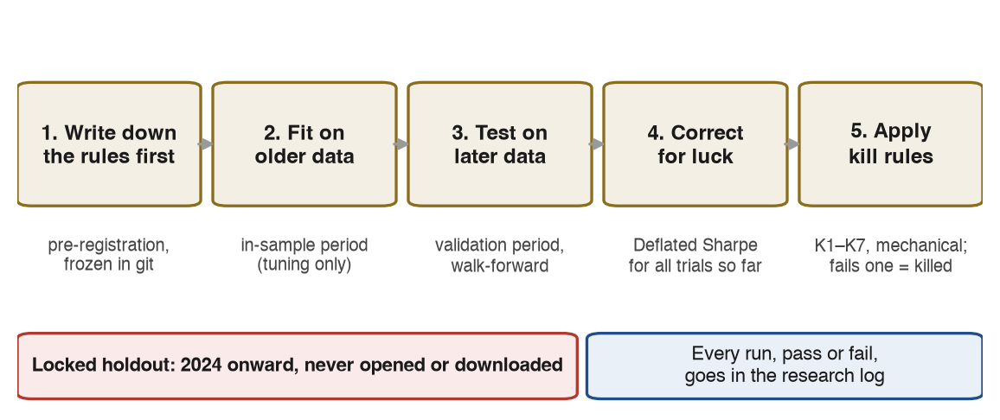
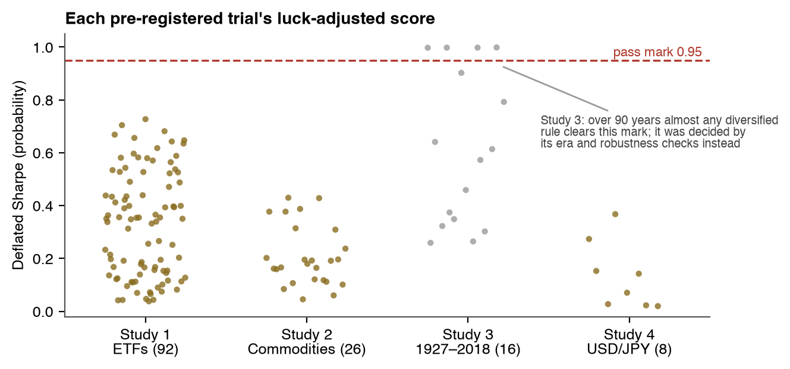
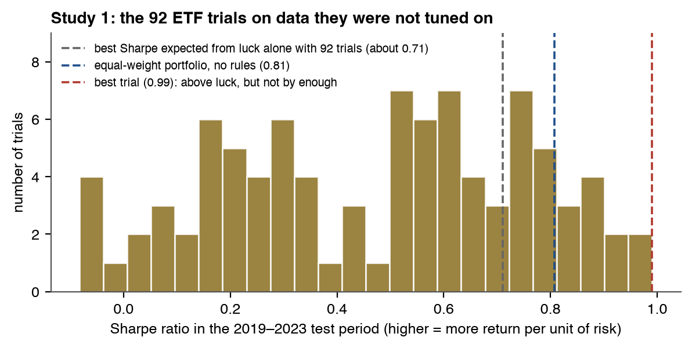
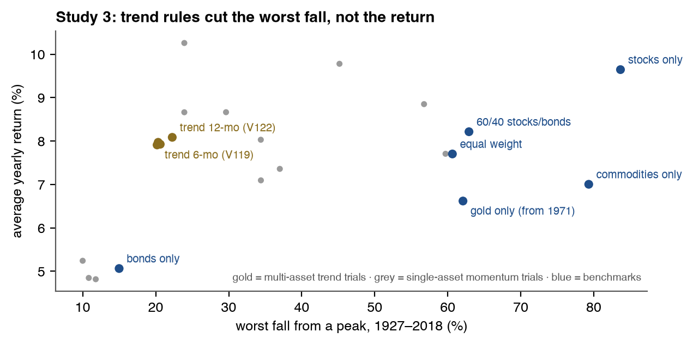
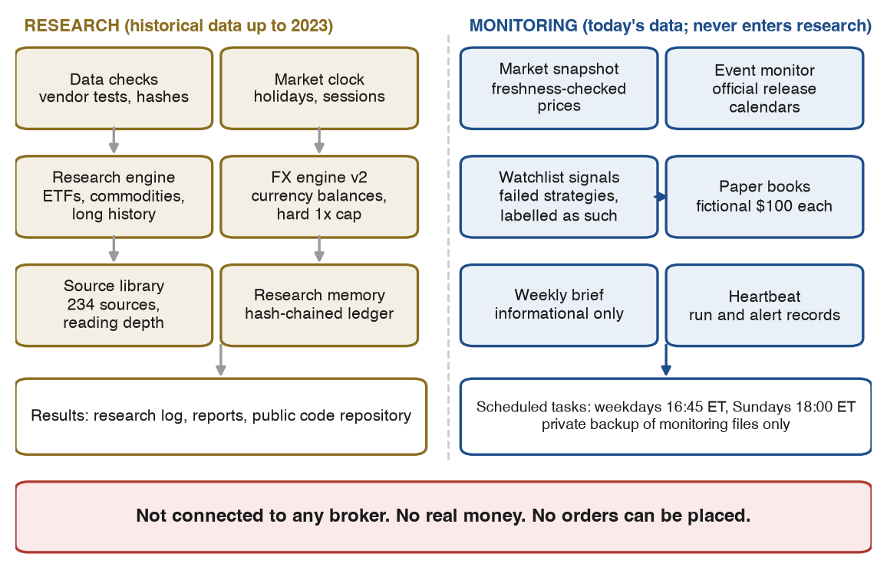

# Can simple trading rules beat a plain diversified portfolio? An honest test

_A personal research project that tested 142 published-style trading rules on gold, stocks, bonds, commodities and the US dollar/Japanese yen exchange rate, using methods designed to catch luck and self-deception. Every rule was written down before it was tested, judged on data it had never seen, and scored with a statistical correction for the number of rules tried. The result: 140 were killed by pre-registered rules; 2 (V119, V122) passed Study 3's primary rule but failed all robustness checks; none was judged robust. Simple benchmarks, such as an equal-weight mix of a few funds, were hard to beat. The project has since become a careful research system: data-quality tests, a tamper-evident research diary, an official economic-event monitor and a fictional-money paper-trading experiment. It is connected to no broker and uses no real money. Figures as of October 28, 2026. Not financial or tax advice. Code, reports and the full research log: [github.com/GarlenWoest/etf-strategy-backtest](https://github.com/GarlenWoest/etf-strategy-backtest)._

### Contents

| Section | | Section | |
|---|---|---|---|
| 1 | Title page and summary | 8 | What it does every day and week |
| 2 | The question | 9 | The paper-trading experiment |
| 3 | How the testing works | 10 | Safeguards |
| 4 | What was tested and what happened | 11 | Limitations and open questions |
| 5 | Key findings and lessons | 12 | What's next |
| 6 | What the system is | 13 | Glossary |
| 7 | What it knows | | |

**How to read this.** Technical terms are explained the first time they appear, and all of them are collected in the glossary (section 13). Trial names like "V122" are simply labels: the project numbered every rule it tested, V001 to V142, in the order they were registered.

## 2. The question

**Can simple, published trading rules beat just holding a diversified portfolio, after costs and after allowing for luck?**

A _trading rule_ here is a mechanical instruction such as "own gold only while its price is above its average of the last 200 days, otherwise hold cash." Books, papers and websites publish many rules like this, often with impressive charts. Those charts usually come from a _backtest_: a simulation of how the rule would have done on past prices.

Backtests are easy to fool yourself with:
- **Too many tries.** Test enough rules and some will look brilliant by pure chance, just as someone in a large room will flip ten heads in a row. This is called _overfitting_ or _data mining_.
- **Tuning on the answer.** If you adjust a rule until it fits the past, it has learned the past's noise, not a lasting pattern.
- **Ignoring costs.** Every trade costs money (the gap between buying and selling prices, plus price slippage). A rule that trades often can lose its whole edge to costs.
- **Peeking.** A simulation can accidentally use information that wasn't available at the time (_lookahead bias_).

The fair comparison is not "did the rule make money?" but "did it beat simply holding a sensible mix?" The project used these _benchmarks_:
- an **equal-weight portfolio** of the same funds (the same amount in each, rebalanced monthly);
- **buy-and-hold** of each asset on its own;
- **60/40** (60% stocks, 40% bonds) for the long-history study;
- **70/30** (70% S&P 500 fund, 30% gold fund) for the commodity study and the paper books;
- **always holding the dollar against the yen**, and **holding nothing**, for the currency study.

## 3. How the testing works

The project was built to make "nothing works" a trustworthy answer, not just "we found something."

**1. Pre-registration: rules are frozen before any test.** Each study's full list of rules, settings, costs, test periods and pass/fail criteria was written down and saved in the project's version history (git) _before_ a single backtest ran. Nothing could be quietly added, dropped or adjusted after seeing results. This idea comes from medical trials, where registering a trial in advance stops researchers from reporting only the outcomes that worked.

**2. Separate periods for tuning and testing.** Each study's history was split:
- an **in-sample** period, used only to see how each setting behaved (for example 2006–2018 for the ETF study);
- a **validation** (out-of-sample) period the rules were judged on (2019–2023 for the ETF and commodity studies, 2015–2023 for the currency study);
- a **holdout**: everything from January 1, 2024 onward. It is **locked**: it has never been opened, or even downloaded. It is saved for one final, separately pre-registered test, if anything ever earns one.

**3. Walk-forward checks.** As a second view, each year the rule's best setting was chosen using only the previous five years, then tested on the next year, the way a real person would have had to use it.

**4. A correction for luck: the Deflated Sharpe.** The _Sharpe ratio_ measures return per unit of risk: the yearly return above a safe cash rate, divided by how much the returns swing. Higher is better. For scale: US stocks had a Sharpe of 0.41 over 1927–2018 in this project's data, and the S&P 500 fund 0.72 in 2019–2023. The _Deflated Sharpe_ (Bailey and López de Prado, 2014) asks: given how many rules have been tried so far, what is the probability that this rule's true Sharpe beats the best result luck alone would produce? The project required **0.95**, and counted trials **cumulatively**: the 142nd rule was judged against the luck of all 142, not just its own study.

**5. Kill rules applied mechanically.** A rule was killed if it failed any one of seven pre-set criteria, K1 to K7. In plain terms:

| Rule | A rule is killed if it… |
|---|---|
| K1 | doesn't beat its benchmarks on the test data |
| K2 | has a Deflated Sharpe below 0.95 (could be luck) |
| K3 | makes money at normal costs but not at double costs |
| K4 | trades too rarely to judge (fewer than 30 trades, or under 5 years of test data for slow rules) |
| K5 | stops working when its setting is nudged to the next value (fragile) |
| K6 | does less than half as well on test data as on tuning data |
| K7 | would have shrunk $100 to $20 in a crash (2008, 2020 or 2022) |

The long-history study used a different, era-based primary rule, explained in section 4. The currency study used its own versions of K1–K7 (for example, K1 there means beating both "always hold dollars" and "hold nothing").

**Costs.** Every simulated trade paid costs, and every result was rerun at two and three times those costs.
- ETFs: 0.07% of the trade one way (0.10% for leveraged funds).
- The 1927–2018 study: published historical cost estimates, much higher in early decades.
- The dollar/yen: 0.015% one way, plus a 0.75% yearly markup on overnight interest.

These cost levels are reasoned assumptions, **not measured costs** (see section 11).

**Other safeguards in the code.**
- Signals use only data up to each day's close, and trades fill at the next day's open. An automated test changes future prices and checks that past decisions don't move.
- 217 automated tests currently pass.
- Every run, including failures, is logged in a research log of 1,125 rows.

## 4. What was tested and what happened

Four studies ran between October 22 and October 26, 2026. Each started only after the previous one was finished and judged.

- **Study 1, ETFs.** _Exchange-traded funds_ (ETFs) are funds that trade like shares. The study used four: gold (GLD), the S&P 500 (SPY), the Nasdaq-100 (QQQ) and long-term US Treasury bonds (TLT). It also used their _leveraged_ versions, which aim for two or three times the daily move. It tested 92 rules across 8 families: trend filters, momentum, short-term "buy the dip" rules, rotation between funds, and volatility-gated leverage.
- **Study 2, commodities.** Gold, silver and oil funds (GLD, SLV, USO) and their 2x versions. It tested 26 rules chosen from a review of 153 sources, including momentum, volatility-scaled trend, real-interest-rate and dollar-trend filters.
- **Study 3, long history (1927–2018).** No new ideas: the two closest near-misses from Study 1 were re-tested on about 90 years of monthly data for US stocks, long-term Treasury bonds, commodity futures and gold. Those were a monthly multi-asset trend rule and single-asset momentum. A rule had to beat both its own buy-and-hold and 60/40 in at least 3 of 4 eras (1927–49, 1950–79, 1980–99, 2000–18).
- **Study 4, US dollar/Japanese yen.** Eight economically motivated currency rules:
  - _carry_, meaning holding the higher-interest-rate currency;
  - interest-rate momentum;
  - carry switched off in risk-off periods;
  - relative bond-yield curve slope.

  They were simulated on a $10,000 virtual account, never borrowing more than the account's value (1x).

### Combined results

| Study | Market and test period | Trials | Cumulative trials | Outcome | Best Deflated Sharpe (pass mark 0.95) |
|---|---|---|---|---|---|
| 1 ETFs | 4 ETFs + 2x/3x versions; tested 2019–2023 | 92 | 92 | 92 killed | 0.73 (V073, multi-asset trend, 6 months) |
| 2 Commodities | Gold, silver, oil + 2x versions; tested 2019–2023 | 26 | 118 | 26 killed | 0.43 (V108, dual momentum, 2x) |
| 3 Long history | Stocks, bonds, commodities, gold; 1927–2018 in 4 eras | 16 | 134 | 14 killed; 2 passed the primary rule, then failed all robustness checks | 0.999 (V122), not meaningful here (see below) |
| 4 USD/JPY | Dollar/yen spot, ≤ 1x; tested 2015–2023 | 8 | **142** | 8 killed | 0.37 (V142, relative curve slope, 126 days) |
| **All** | | **142** | | **140 killed by pre-registered rules; 2 (V119, V122) passed Study 3's primary rule but failed all robustness checks; none judged robust** | |

**Why V119 and V122 aren't counted as successes.** These two multi-asset trend rules (6- and 12-month averages) passed 3 of 4 eras at normal costs. The pre-registered robustness checks then showed:
- at double or triple costs, or with signals delayed one extra month, they fell to 2 eras or fewer;
- their neighbouring settings (8 and 10 months) passed only 2 eras;
- over the full 90 years they earned about the same as equal weight (8.1% a year vs 7.7%; the gap isn't statistically significant) and less than 60/40 (8.2%).

Over 90 years the Deflated Sharpe only tests whether a Sharpe is above zero, which even plain equal weight clears (Sharpe 0.49). So it can't separate good rules from ordinary ones there.

**What the near-misses looked like in Study 1.**

| Series | Test-period Sharpe | Yearly return | Worst fall |
|---|---|---|---|
| V073 multi-asset trend, 6 months (best Deflated Sharpe) | 0.99 | 10.3% | −11.6% |
| Equal-weight portfolio (benchmark, no rules) | 0.81 | 12.0% | −25.6% |
| SPY buy-and-hold (benchmark) | 0.72 | 15.8% | −33.7% |

The best rule had the smoothest ride but earned less than simply holding the four funds. From $100 in 2006, the four unleveraged near-misses ended 2023 with $355–$428. Equal weight ended with $530 and SPY with $529.

## 5. Key findings and lessons

**1. With many trials and five years of test data, luck is a high bar.** Five years of daily returns pin down a Sharpe ratio only to within about ±0.45. With 92 trials, the best result expected from pure noise is a Sharpe of about 0.71. Study 1's best real result, 0.99, cleared that, but not by enough to be 95% confident. For the currency study's length of data, the luck level for the best of 142 trials was about 0.58.

**2. Diversification was the quiet winner.** Equal weight across gold, stocks, tech and bonds had a test-period Sharpe of 0.81, higher than the S&P 500's 0.72, with no rules at all. The 70/30 stock/gold mix (Sharpe 0.82) beat every commodity rule. Simply holding dollars against the yen (0.24) beat 5 of the 8 currency rules.

**3. Trend rules are a risk tool, not a return engine.**
- Over 1927–2018, multi-asset trend rules cut the worst fall from about 61% (equal weight) and 63% (60/40) to about 20–22%.
- They did so while earning roughly the same yearly return.
- That's valuable for someone who can't stomach large losses, but it isn't an "edge".

**4. Most edges were fragile.**
- 86 of 92 ETF rules failed the "neighbour" test: nudge the setting and the result fell apart.
- The best commodity results came almost entirely from holding oil during its 2021–2022 rally. In 2023 the same rule lost 28% (49% at 2x).
- The best currency rule had a _negative_ Sharpe on its tuning period, and its neighbouring setting had a negative Sharpe on the test data.

**5. Costs matter most for busy rules.** The short-term "buy the dip" family traded its whole account 11–32 times a year. At triple costs its Sharpe fell by up to 0.41.

**6. Check the tools before trusting the results.** Later audits found real defects, recorded openly:
- **The first currency engine had three accounting defects.** One let a long-held position drift down to about a third of its intended size. None of them changed a verdict, and the frozen results were left as they were, with the defects disclosed. A corrected engine (v2) exists for future work.
- **The market calendar had one error.** It treated a Federal Reserve Board holiday rule incorrectly; this is fixed, and no study was affected.
- **A data vendor's documentation was wrong.** Its stated time zone was wrong, and the convention even changed between years (section 7). Only tests against known events caught it.

**7. Popularity isn't evidence.** A survey of the 20 most-starred trading-strategy projects on GitHub found that 0 clearly show out-of-sample results, 0 show a live or paper-trading record, and only 2 show results that include costs.

**8. For a small account, saving matters more than strategy.** Adding $100 a month reaches $1,000 in 9 months. In an illustrative simulation (labelled not validated), even the best near-miss took a median of about 11 years to grow $100 to $1,000 on its own.

## 6. What the system is

After the four studies, the project was rebuilt into a research system. It is designed to stop the next study from being fooled by bad data, bad accounting or wishful thinking. It has two strictly separated halves: research on historical data, and monitoring of today's markets. Monitoring data never enters research: automated tests check that no research code reads it.

| Part | What it does |
|---|---|
| **Research engine** | Simulates daily, long-only trading of funds with costs, cash interest and dividends; runs walk-forward, bootstrap confidence intervals, the Deflated Sharpe and the kill rules |
| **FX engine v2** | A currency simulator that tracks real dollar and yen balances, charges every trade, and enforces a **hard 1x limit**: any close above 1.00x is trimmed back to 0.95x. Version 1 stays frozen as the record for Study 4; v2 is for future pre-registered work only |
| **Market clock** | Trading sessions and holidays for New York, London and Tokyo, checked against real data: Japan's bank holidays match exactly over 1990–2023; the UK list matches the government's; the New York Stock Exchange matches except for 4 unscheduled closures |
| **Data checks** | Pre-set quality tests (Q1–Q9: licence, time zone, anchoring to official rates, second-vendor agreement, bid/ask sanity, coverage, weekends, stale prices and outliers, reproducibility); every raw file is fingerprinted (SHA-256) |
| **Research memory** | An append-only diary of decisions, results, errors, corrections and open questions (83 records). Each record includes a fingerprint of the one before it, so any later edit breaks the chain and is detected |
| **Source library** | 234 sources (papers, official documents, books) with a recorded reading depth, plus a tool that answers "what's the evidence for and against this idea?" |
| **Current-market snapshot** | Read-only prices for dollar/yen, pound/dollar and gold, each labelled with its source, timestamp, age and a freshness status (live, delayed, last price at the close, current official reference, stale, or unavailable) |
| **Event monitor** | Reads official release calendars and feeds (Federal Reserve, US Bureau of Labor Statistics, Bureau of Economic Analysis, Bank of Japan, Japan's Ministry of Finance, UK Office for National Statistics) |
| **Paper books** | Four fictional $100 portfolios tracked in local files (section 9) |
| **Scheduled tasks and heartbeat** | A weekday and a Sunday run (section 8); the _heartbeat_ records each run's start, steps, finish and notification delivery, and flags missed runs |
| **Backups** | Code and reports in a public GitHub repository. The fictional paper records go to a separate private repository, which may only ever contain those monitoring files |

The code is written in Python. The monitoring scripts are plain programs: they make no calls to an AI model and poll official sources at most a few times a day. The two scheduled tasks, though, are sessions of Claude, an AI assistant, which run those scripts in a fixed order. On Sundays Claude also writes the weekly brief and makes Book B's decision (section 9). Claude also wrote most of the project's code and reports under the owner's direction and approval.

## 7. What it knows

### The research library

The library holds **234 sources, of which 190 are kept** (40 rejected, 4 duplicates). An October 2026 audit found that earlier "read" labels overstated what had actually been read. So the library now records only reading depth that has been verified:

| Reading depth | Sources | Meaning |
|---|---|---|
| L0 | **207** | Listed and summarised; depth of reading not recorded |
| L1 | 16 | Abstract checked against the source's own page |
| L2 | 5 | Content reviewed (method, data, results) |
| L3 | 6 | Reproduced, but only the project's own results; no outside paper's method has been reproduced |

**Coverage by market:**
- **Dollar/yen (28 kept sources):** 23 have been checked against their official pages. 23 corrections were made to library entries, including two wrong paper titles, one wrong year and two claims the sources didn't support.
- **Gold:** 42 of its 46 kept sources are still at L0.
- **Pound/dollar:** not yet audited.

**Honest summary:** the library is a well-organised reading list, and only partly a verified body of knowledge.

### Data sources and their verified quality

| Data | Source | What has been checked |
|---|---|---|
| Daily ETF prices, 2004–2023 | Yahoo Finance | Only source; an independent cross-check (Stooq) was impossible. Two suspect stale-price stretches (QQQ 2012, UGL 2018) were tested by interpolating them; no conclusion changed |
| Leveraged ETFs before launch (2008–2010) | Built from the underlying fund | Tracks the real funds at correlation 0.996–0.999 after launch, but about 1 percentage point a year off in 2019–2023 |
| Dollar/yen daily rate | Federal Reserve H.10 noon rate (via FRED) | 3 stale 2007 holiday rows found and recorded |
| 1927–2018 returns | Ken French data library, AQR, FRED yields, World Bank gold | Bond returns match Shiller's independent series at correlation 1.000 once dates are aligned |
| Dollar/yen tick data, 2018–2019 | HistData (free) | **Approved for daily-level use only.** Intraday use is blocked until a second vendor confirms the timestamps |

**The HistData timestamp finding.**
- HistData's documentation says its timestamps are fixed Eastern Standard Time without daylight saving (UTC−5).
- **Tests against known events showed this is wrong.** The events were US jobs-report releases at 8:30:00 New York time, the Fed's noon rate and the weekend market close.
  - In 2019 the data behaves like UTC−5 shifted by European summer time.
  - In 2018 it behaves like New York local time (an exploratory finding, not yet tested on a third year).
- **The convention changed between November 2018 and March 2019.**
  - The reading found in 2019 failed its pre-registered test on 2018: 9 of 12 jobs releases landed in the right 0–5-second window, and 11 were required.
  - So every year must be tested before use, and no correction derived from HistData itself is adopted.
- **Other findings:** a duplicated hour (2,360 identical rows on October 27, 2019) is now removed automatically. The vendor's typical spread halved between the two years, which may mean the underlying feed changed.
- **Not yet done:** the cross-check against a second free vendor (TrueFX) hasn't happened, because those files haven't been obtained.

### Current-market and event coverage

**Market snapshot.**
- The first snapshot (October 28) rated all three markets "DATA OK".
- Yahoo's dollar/yen and pound/dollar prices were compared with two official references at their documented times: the European Central Bank's daily rate and the Fed's noon rate. Over 22 moments in 7 days they agreed within 2.1 and 3.6 _pips_. A pip is the fourth decimal place of a rate, or the second for yen.
- That shows the prices are sensible. **It does not show** what a trade would actually cost, how delayed the feed is, or anything about gold: no free, licensed source exists for those.
- Yahoo's own bid/ask fields were inconsistent, so they are rejected automatically.

**Event monitor.**
- It holds 133 events from the official sources: 63 published, 25 scheduled and 45 past events not confirmed by a feed.
- It records each release's official time, and short verbatim facts from it, such as the Fed's decision sentence on October 28.
- It stores **no forecasts and no interpretation**: no licensed source of economists' consensus forecasts exists, so it never claims a "surprise".
- The Bank of England's site blocks automated readers, so it isn't covered.

## 8. What it does every day and week

Two scheduled tasks run inside the Claude desktop app. They run only while the app is open and the computer is awake; a missed run catches up at the next launch, and the heartbeat records the gap.

| When | What happens |
|---|---|
| **Weekdays, 4:45 p.m. New York time** | 1. Heartbeat start, and a check for a gap of more than 3 trading days since the last run. 2. Watchlist signals for two failed rules (labelled NOT VALIDATED, FAILED TESTING). 3. Paper-book update: fill pending fictional trades at the open, credit dividends and cash interest, value every book. 4. Market snapshot. 5. Official event poll. 6. Notifications for signal changes, fictional trades, checkpoints and errors, each with its delivery recorded. 7. Heartbeat finish |
| **Sundays, 6:00 p.m. New York time** | 1. Heartbeat status line for the week. 2. Book B's one weekly fictional decision, written to a fingerprinted journal. 3. A one-page weekly market brief (informational only; reputable and official sources; no trade ideas). 4. Private backup of the monitoring files. 5. Notifications, with delivery recorded |

**Status as of October 28:**
- The weekday task ran on October 23, 26, 27 and 28, and the Sunday task on October 25. All were recorded as succeeded. The backup step of the October 25 run failed, because the private repository didn't exist yet; it works now.
- **Not yet run on schedule:** steps 4 and 5 (market snapshot and event poll) and the per-step and delivery records. They were added on October 28, after that day's run had started, so the first scheduled run to include them is October 29. So far they have been run by hand.
- **Known gap:** four fictional-trade notifications on October 26 were not delivered, while the run still showed "ok". That finding is why delivery is now recorded.

## 9. The paper-trading experiment

**PAPER, FICTIONAL MONEY. Too early to judge.**

_Paper trading_ means tracking imaginary trades at real market prices without spending money. Four fictional $100 books started at the market open on **October 26, 2026**:

| Book | Rules |
|---|---|
| **A, rules** | $50 follows V122 (multi-asset trend, using stand-in funds) and $50 follows V074 (the leveraged version of the 6-month trend rule). Both **failed testing**; they are followed to see how failed rules behave live, not because they're expected to work |
| **B, discretionary** | One written judgment call per week (buy, sell or no trade), made by the Claude AI assistant in the Sunday task, from 12 funds; long only, no borrowing, at least 5 trading days' hold. Each decision is written _before_ its trade, with its reasoning, what would prove it wrong and its planned exit, then fingerprinted so it can't be edited later |
| **SPY** | Benchmark: 100% S&P 500 fund |
| **70/30** | Benchmark: 70% SPY, 30% gold fund |

**Rules common to all four books:**
- Trades fill at the next market open, with the same costs as Study 1.
- Cash earns Treasury-bill interest.
- No book can borrow. Book A's leveraged funds do give economic exposure of about 1x of the whole book, and Book B could in principle reach about 3x through a 3x fund. From the next update, the books table also shows each book's exposure.

**Values after 3 trading days (October 28 close):**

| Book | Value | Change |
|---|---|---|
| A, rules | $101.64 | +1.64% |
| B, discretionary (25% in a gold fund, 75% cash) | $100.43 | +0.43% |
| SPY benchmark | $101.25 | +1.25% |
| 70/30 benchmark | $101.36 | +1.36% |

**Three days of results are noise and say nothing about skill.** Planned checkpoints:
- a 2-week report on November 6, 2026, labelled "statistically meaningless";
- a 3-month summary on January 26, 2027.

No conclusion will be drawn before then, and even 3 months is short.

## 10. Safeguards

**Money and brokers**
- There is no broker connection and no real money. The system has no way to place an order.
- It holds no brokerage logins and handles no passwords or tokens.
- Even a strategy that passed every test would not start live trading automatically.

**The holdout**
- The data from 2024 onward has never been opened or downloaded.
- Only the project owner can unlock it, with an explicit instruction.
- Today's monitoring prices fall inside that period, so they are kept out of all research.

**Honesty rules**
- Failed strategies stay failed, and historical results are immutable.
- Mistakes are logged as corrections, not erased.
- Any new test must be pre-registered first.
- Strategy research has been paused since October 26, 2026, until a specific new question is approved.

**Privacy**
- The public repository holds code, reports and the project's own logs: no price data files and no paper-trading records.
- A final audit (October 28) scanned every file in every commit and found no secrets, tokens or personal email addresses. Its only personal finding was one file path, in a report, that includes the computer's account name.
- The private backup holds only the fictional paper records, run logs and weekly briefs (16 files at the last check).
- The contact address that the Bureau of Labor Statistics asks automated readers to send is read from the computer's settings at run time and written to no file.

**Data licensing**
- Raw vendor prices are never published; only aggregate results are.
- HistData is limited to daily-level use, and a vendor whose terms forbid building a database (Dukascopy) is not used.
- Gold benchmark prices that need a licence (LBMA) aren't used.
- Official sources are used within their stated terms. For example, the ECB's rates are for information only, so they serve as a check, never as a trading price.
- Software from GitHub is read, never installed or run without approval.

## 11. Limitations and open questions

**Limitations**
- **Costs are assumptions, not measurements.** No free source shows what a broker would really charge, and Yahoo's bid/ask data is unusable. Measuring costs would need a broker's practice account or a paid feed.
- **One price vendor per market** (Yahoo for funds, the Fed's noon rate for dollar/yen), with no independent check of the daily data.
- **Short, unusual test windows.** 2019–2023 was a boom for US tech stocks and one of the worst periods ever for long-term bonds.
- **Simulated history.** Leveraged funds before their 2008–2010 launches are modelled. Study 3 uses index returns that no investor could have bought before index funds existed, and gold and bond data that are monthly averages.
- **The first currency engine's defects** are disclosed but not corrected in the frozen results; a diagnostic rerun showed no verdict would change.
- **Intraday data hasn't passed.** HistData's timestamps are unconfirmed for any year until a second vendor agrees.
- **The calendar doesn't model** early closes or thin holiday trading.
- **The monitoring depends on a laptop.** Nothing runs while the computer sleeps or the app is closed.
- **The weekly brief can't reach** some major news sources (Reuters, AP, WSJ, FT); it says so when that happens.
- **No consensus forecasts**, so no measure of economic "surprises".

**Open questions recorded in the research memory**
- What do real trading costs for these instruments look like, and does any near-miss survive them?
- Is HistData's change in 2019 a change of underlying feed (its spreads halved the same year)?
- How does the dollar/yen behave after Japanese government currency interventions? This is a descriptive study using official publication dates, not a trading rule.
- Should a paper stop-loss be allowed to override Book B's minimum 5-day hold? Today it doesn't, and stops fill at the next open, not at the stop level.

## 12. What's next

The code, reports and research log are public at [github.com/GarlenWoest/etf-strategy-backtest](https://github.com/GarlenWoest/etf-strategy-backtest), so anyone can check the work or follow what happens next.

**Scheduled and certain**
- October 29: check that the first scheduled run includes the snapshot, event poll, step and delivery records.
- Weekly Book B decisions every Sunday.
- The 2-week paper checkpoint (November 6) and the 3-month summary (January 26, 2027).

**Waiting on something**
- **The cross-vendor check of the tick data** needs the TrueFX files, which the owner must download after registering. Until then, intraday research stays blocked.
- **Session and intraday research** is postponed until that check passes.

**Not yet decided (each needs the owner's approval)**
- A daily report and forecast scorecard.
- Verifying the gold and pound/dollar parts of the library.
- Whether to use a source of executable prices (for example a broker's practice account) to measure real costs.
- Any new pre-registered study. If one happens, the lessons say it should test **fewer, better-motivated ideas, across many markets, with longer test data and measured costs**. Then, and only then, it could have a single run on the locked 2024+ holdout.

## 13. Glossary

| Term | Meaning |
|---|---|
| 60/40, 70/30 | Fixed mixes: 60% stocks and 40% bonds; 70% S&P 500 fund and 30% gold fund. Rebalanced monthly |
| Backtest | A simulation of how a rule would have performed on past prices |
| Benchmark | A simple alternative a rule must beat, such as buy-and-hold or equal weight |
| Bid/ask, spread | The prices at which you can sell (bid) and buy (ask); the gap between them is a cost of trading |
| Bootstrap confidence interval | A range for a result, found by re-sampling the data many times (10,000 here) |
| Buy-and-hold | Buy once and keep, with no trading rule |
| CAGR | Compound annual growth rate: the average yearly return, with compounding |
| Carry | Holding the currency with the higher interest rate to earn the rate difference |
| Cumulative trials (N) | The total number of rules tried across all studies so far; the luck correction grows with it |
| Deflated Sharpe | The probability that a rule's true Sharpe ratio beats the best result expected by chance, given how many rules were tried. The pass mark here is 0.95 |
| Drawdown (worst fall) | The largest drop from a previous peak, in percent |
| Equal weight | The same amount in each asset, rebalanced monthly |
| ETF | Exchange-traded fund: a fund that trades on a stock exchange like a share |
| FOMC | The Federal Reserve's committee that sets US interest rates |
| Hash chain, fingerprint | A short code computed from a record's content; each diary record includes the previous one's, so any edit is detectable |
| Heartbeat | The record of each scheduled run: started, steps, finished, notifications delivered |
| Holdout | Data set aside and never looked at, for one final test (here, 2024 onward) |
| In-sample, out-of-sample | The period used to tune a rule, and the later period used to judge it |
| Kill rules (K1–K7) | Pre-set criteria; failing any one ends a rule's test |
| Leveraged ETF (2x, 3x) | A fund that aims for two or three times its index's daily move, up or down |
| Lookahead bias | Accidentally using information in a simulation that wasn't available at the time |
| Momentum (time-series) | Holding an asset while its own past return (e.g. over 12 months) is positive |
| Overfitting | Tuning a rule so closely to past data that it captures noise rather than a lasting pattern |
| Paper trading | Tracking imaginary trades at real prices, with no real money |
| Pip | The smallest usual unit of an exchange rate: 0.0001 for most rates, 0.01 for yen rates |
| Pre-registration | Writing down every rule, setting and pass criterion before testing |
| Rollover | The daily interest paid or earned for holding a currency position overnight |
| Sharpe ratio | Yearly return above a safe cash rate, divided by the volatility of returns; return per unit of risk |
| Slippage | The difference between the expected price and the price a trade actually gets |
| Tick data | Every individual price quote, often many per second |
| Trend rule (moving average) | Hold an asset while its price is above its average over a past window, otherwise hold cash |
| Walk-forward | Repeatedly choosing a setting using only past data, then testing it on the next period |
