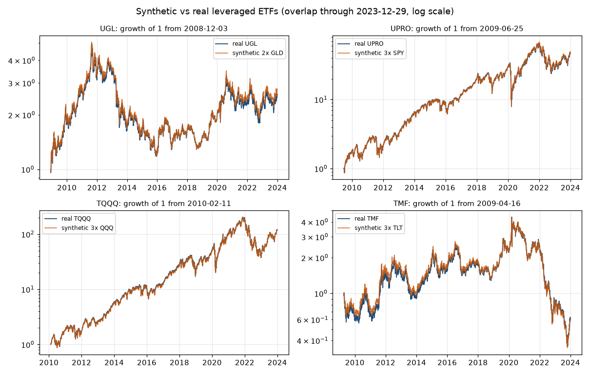

# Data quality report (Phase 2)

_Generated 2026-10-22T19:32:10Z. Holdout (2024-01-01 onward) not downloaded: holdout_locked = true._

## Provenance

| Item | Value |
|---|---|
| Source | Yahoo Finance via yfinance (auto_adjust=True: open, high, low, close all split- and dividend-adjusted) |
| Downloaded (UTC) | 2026-10-22T19:27:50Z |
| Range requested | 2004-01-01 to 2024-01-01 (exclusive) |
| yfinance | 1.7.0 |
| Python / pandas / numpy | 3.14.8 / 3.1.0 / 2.5.4 |
| Random seed | 20261022 (not used in Phase 2) |
| Calendar | SPY trading days, 2004-11-18 to 2023-12-29, 4811 days |

Raw file hashes are in `data/raw/download_meta.json`; clean file hashes in `data/clean/build_meta.json`.

**Caveat on adjusted prices:** Yahoo adjusts history for dividends paid later, including after 2023. Levels before 2024 may therefore be rescaled by holdout-period dividends. Returns are unaffected except for that scaling, and no holdout prices are in the data.

## Raw downloads

| File | Rows | First | Last |
|---|---|---|---|
| yahoo_adj/GLD.csv | 4811 | 2004-11-18 | 2023-12-29 |
| yahoo_unadj/GLD.csv | 4811 | 2004-11-18 | 2023-12-29 |
| yahoo_adj/SPY.csv | 5033 | 2004-01-02 | 2023-12-29 |
| yahoo_unadj/SPY.csv | 5033 | 2004-01-02 | 2023-12-29 |
| yahoo_adj/QQQ.csv | 5033 | 2004-01-02 | 2023-12-29 |
| yahoo_unadj/QQQ.csv | 5033 | 2004-01-02 | 2023-12-29 |
| yahoo_adj/TLT.csv | 5033 | 2004-01-02 | 2023-12-29 |
| yahoo_unadj/TLT.csv | 5033 | 2004-01-02 | 2023-12-29 |
| yahoo_adj/UGL.csv | 3794 | 2008-12-03 | 2023-12-29 |
| yahoo_unadj/UGL.csv | 3794 | 2008-12-03 | 2023-12-29 |
| yahoo_adj/UPRO.csv | 3654 | 2009-06-25 | 2023-12-29 |
| yahoo_unadj/UPRO.csv | 3654 | 2009-06-25 | 2023-12-29 |
| yahoo_adj/TQQQ.csv | 3495 | 2010-02-11 | 2023-12-29 |
| yahoo_unadj/TQQQ.csv | 3495 | 2010-02-11 | 2023-12-29 |
| yahoo_adj/TMF.csv | 3703 | 2009-04-16 | 2023-12-29 |
| yahoo_unadj/TMF.csv | 3703 | 2009-04-16 | 2023-12-29 |
| yahoo_adj/IRX.csv | 5028 | 2004-01-02 | 2023-12-29 |

## Validation results

Checked: duplicate dates, NaN prices, zero or negative prices, OHLC consistency, missing trading days against the SPY calendar, single-day moves over 10% (flagged, kept), and runs of 3+ identical closes.

**No duplicates, no NaNs, no zero or negative prices, no OHLC inconsistencies, no missing days.**

| Ticker | Check | Count | First dates | Note |
|---|---|---|---|---|
| GLD | gap_close_to_close | 1 | 2008-09-17 | flag only, kept (>10%) |
| SPY | gap_close_to_close | 3 | 2008-10-13, 2008-10-28, 2020-03-16 | flag only, kept (>10%) |
| SPY | gap_prev_close_to_open | 1 | 2020-03-16 | flag only, kept (>10%) |
| QQQ | gap_close_to_close | 3 | 2008-10-13, 2008-10-28, 2020-03-16 | flag only, kept (>10%) |
| QQQ | stale_close_run | 1 | 2012-08-29 | close unchanged for 3+ days |
| UGL | gap_close_to_close | 6 | 2011-09-23, 2012-02-29, 2013-04-15, 2013-06-20, 2020-03-24, 2020-08-11 | flag only, kept (>10%) |
| UGL | gap_prev_close_to_open | 3 | 2013-04-15, 2016-06-24, 2020-03-24 | flag only, kept (>10%) |
| UGL | stale_close_run | 1 | 2018-05-22 | close unchanged for 3+ days |
| UPRO | gap_close_to_close | 50 | 2010-05-10, 2010-05-20, 2010-05-27, 2010-06-04, 2011-08-04, 2011-08-08 ... | flag only, kept (>10%) |
| UPRO | gap_prev_close_to_open | 15 | 2010-05-10, 2015-08-24, 2016-06-24, 2020-03-09, 2020-03-10, 2020-03-12 ... | flag only, kept (>10%) |
| TQQQ | gap_close_to_close | 83 | 2010-05-10, 2010-05-20, 2010-05-27, 2010-06-29, 2011-08-04, 2011-08-08 ... | flag only, kept (>10%) |
| TQQQ | gap_prev_close_to_open | 18 | 2010-05-10, 2015-08-24, 2015-08-25, 2016-06-24, 2018-10-26, 2020-02-24 ... | flag only, kept (>10%) |
| TMF | gap_close_to_close | 19 | 2010-05-06, 2011-08-04, 2011-08-11, 2011-09-22, 2011-10-27, 2011-10-31 ... | flag only, kept (>10%) |
| TMF | gap_prev_close_to_open | 3 | 2020-03-06, 2020-03-09, 2020-03-16 | flag only, kept (>10%) |

**Suspected stale prices (flagged, not changed):**
- QQQ showed the same unadjusted close on three consecutive days (2012-08-27, -28 and -29), with different volumes and ranges each day. On 08-29 the open also equals that close.
- UGL showed the same close on three consecutive trading days (2018-05-18, -21 and -22), with different volumes.
- Both look like Yahoo data errors. **Status: UNRESOLVED.** No second source was available, so they could not be confirmed or fixed, and the clean data keeps Yahoo's values unchanged.
- **Phase 5 safeguard (user instruction):** every surviving strategy is run twice: once as is, and once with closes in these windows (QQQ 2012-08-27 to 2012-08-29, UGL 2018-05-18 to 2018-05-22) replaced by linear interpolation between the neighboring good closes (`src/data.interpolate_suspects`). Any change in results is reported.

**Large moves:** every >10% move falls on a known market event (Sep–Oct 2008, May 2010, Aug 2011, Apr–Jun 2013 gold crash, Aug 2015, Jun 2016 Brexit, Mar 2020) or is a 2x/3x fund amplifying one. All are kept.

## Cash rate (^IRX)

- Daily rate = (IRX / 100) / 252 on SPY trading days.
- Forward-filled on 5 ETF trading days where IRX had no print (bond-market holidays): 2005-10-10, 2005-11-11, 2006-10-09, 2010-10-11, 2016-11-11.
- Negative T-bill yields on 7 days (2020-03-19 to 2020-03-27). These are real market prints and kept as is.

## Synthetic leveraged series

Formula: r = L × r_underlying − expense_ratio/252 − (L − 1) × prior-day daily T-bill rate − extra_drag/252. Open, high and low map the underlying's move from the prior close at L× exposure. Real fund data is used from its first Yahoo date; before that the synthetic series is scaled to join without a jump.

| Fund | L | Expense ratio | Real data from | Synthetic before |
|---|---|---|---|---|
| UGL | 2 | 0.95% | 2008-12-03 | GLD back to 2004-11-18 |
| UPRO | 3 | 0.88% | 2009-06-25 | SPY back to 2004-11-18 |
| TQQQ | 3 | 0.94% | 2010-02-11 | QQQ back to 2004-11-18 |
| TMF | 3 | 1.01% | 2009-04-16 | TLT back to 2004-11-18 |

### Calibration: extra annual cost (user decision, option ii)

Real funds lagged the plain formula. Per fund, extra_drag = mean daily (synthetic − real) return × 252, measured **only on the overlap through 2018-12-31** (in-sample). It is then charged as extra_drag/252 per day on the whole synthetic history. Validation and holdout data play no part.

| Fund | Calibration window | Days | Extra drag (per year) |
|---|---|---|---|
| UGL | 2008-12-03 to 2018-12-31 | 2535 | 1.11% |
| UPRO | 2009-06-25 to 2018-12-31 | 2395 | 0.88% |
| TQQQ | 2010-02-11 to 2018-12-31 | 2236 | 0.90% |
| TMF | 2009-04-16 to 2018-12-31 | 2444 | 1.21% |

### Tracking over the full overlap (daily close-to-close returns)

| Fund | Overlap | Correlation | Tracking error (ann.) | Real CAGR | Formula CAGR (no drag) | Calibrated CAGR | Overnight corr. |
|---|---|---|---|---|---|---|---|
| UGL | 2008-12-04 to 2023-12-29 | 0.9964 | 2.72% | 6.48% | 8.14% | 6.95% | 0.9898 |
| UPRO | 2009-06-26 to 2023-12-29 | 0.9983 | 3.00% | 30.48% | 31.99% | 30.84% | 0.9950 |
| TQQQ | 2010-02-12 to 2023-12-29 | 0.9988 | 3.14% | 41.25% | 42.54% | 41.27% | 0.9966 |
| TMF | 2009-04-17 to 2023-12-29 | 0.9966 | 3.82% | -3.42% | -2.44% | -3.62% | 0.9908 |

**Check on years not used for calibration (2019–2023):**

| Fund | Real CAGR | Calibrated synthetic CAGR | Gap |
|---|---|---|---|
| UGL | 11.34% | 12.80% | +1.46 pp |
| UPRO | 26.35% | 27.53% | +1.18 pp |
| TQQQ | 40.86% | 41.84% | +0.98 pp |
| TMF | -18.54% | -19.24% | -0.70 pp |

After calibration, the full-overlap CAGR gap is small. In 2019–2023 (not used for calibration) the calibrated synthetic was too optimistic for UGL (+1.46 pp/yr), UPRO (+1.18 pp/yr), TQQQ (+0.98 pp/yr) and too pessimistic for TMF (-0.70 pp/yr). **This was not re-tuned:** that would use validation data. The pre-launch synthetic history (2004 to 2008–2010) therefore carries an error of about a point a year in either direction, stated here.

_Chart shows the calibrated synthetic series._

## Cross-check against a second source (Stooq)

**Skipped (user decision 2026-10-22, option C).** Stooq's CSV endpoint now serves a JavaScript bot-verification page instead of data, and no other free source was judged worth the trouble. All prices therefore rest on a single source (Yahoo Finance via yfinance). The Phase 3 unit tests and the Phase 5 suspect-price sensitivity run are the remaining safeguards.

## Expense ratios used

- **UGL:** 0.95% (ProShares UGL page (S20))
- **UPRO:** 0.88% (ProShares UPRO page (S18))
- **TQQQ:** 0.94% (ProShares TQQQ page (S19), GROSS per user decision)
- **TMF:** 1.01% (SEC 497K summary prospectus 2026-02-27 (EDGAR 0001193125-26-078552): gross 1.01%, net 0.90% after cap through 2027-09-01; GROSS used, consistent with TQQQ)

Today's expense ratios are applied to the whole synthetic history. This is an approximation.

