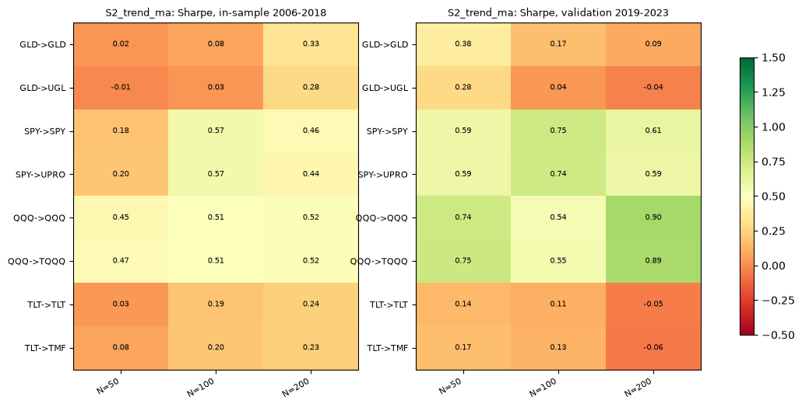
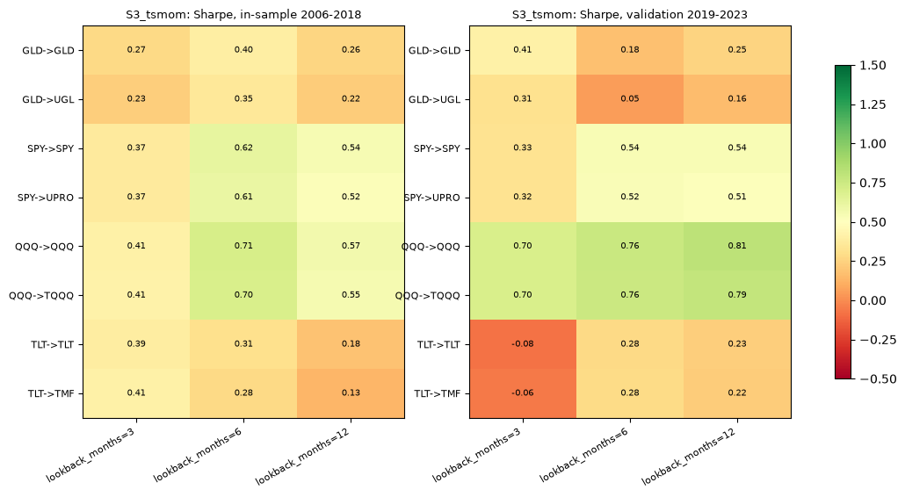
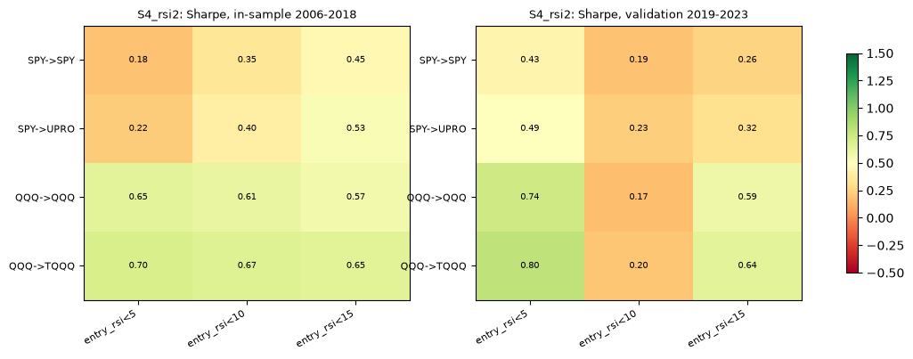
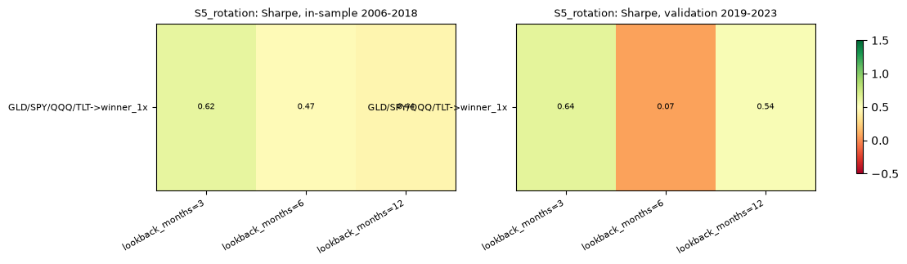
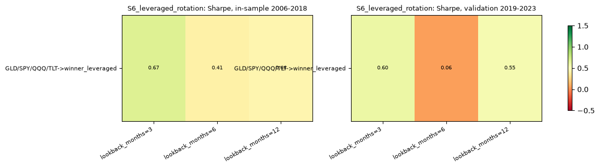
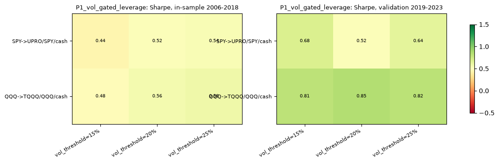
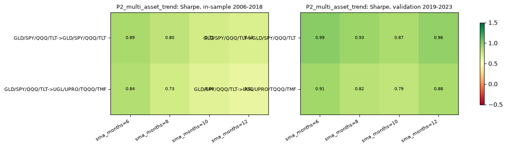
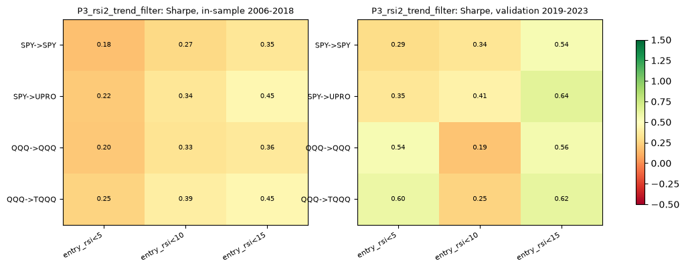

# Phase 5: validation

## Result

- **13 of 92 trials beat the equal-weight benchmark out of sample** (validation 2019–2023: Sharpe above equal weight's 0.81). **9 of them also beat buy-and-hold of their own instrument(s).**
- **Walk-forward 2011–2023 (stitched, per strategy group): 1 of 30 groups beat equal weight** (0.86 over the same years), and 1 of those also beat their own buy-and-hold.
- **No trial reaches a Deflated Sharpe probability of 0.95.** With N = 92, a validation Sharpe must clear about 0.71 just to equal the best-of-92 luck level. Five years of data leaves wide error bars.

**Best 5 by validation Sharpe:**

| ID | Strategy | Trades in | Params | Validation Sharpe | 95% bootstrap CI | **DSR (N=92)** | DSR (effective N≈5) | In-sample Sharpe | Validation CAGR | Validation max DD |
|---|---|---|---|---|---|---|---|---|---|---|
| V073 | P2_multi_asset_trend | GLD/SPY/QQQ/TLT | sma_months=6 | 0.99 | [0.13, 1.92] | **0.727** | 0.922 | 0.89 | 10.3% | -11.6% |
| V079 | P2_multi_asset_trend | GLD/SPY/QQQ/TLT | sma_months=12 | 0.96 | [0.06, 1.86] | **0.705** | 0.912 | 0.69 | 9.9% | -11.5% |
| V075 | P2_multi_asset_trend | GLD/SPY/QQQ/TLT | sma_months=8 | 0.93 | [0.05, 1.84] | **0.682** | 0.901 | 0.80 | 9.8% | -11.5% |
| V074 | P2_multi_asset_trend | UGL/UPRO/TQQQ/TMF | sma_months=6 | 0.91 | [0.00, 1.82] | **0.669** | 0.894 | 0.84 | 22.4% | -32.5% |
| V021 | S2_trend_ma | QQQ | N=200 | 0.90 | [0.02, 1.81] | **0.656** | 0.888 | 0.52 | 17.6% | -23.3% |

All five confidence intervals reach down to roughly zero. Their DSRs (0.67–0.73) mean about a 1-in-4 to 1-in-3 chance the best result is luck from testing 92 variants. Even with the lenient effective N, none reaches 0.95. **On the pre-agreed rule (DSR ≥ 0.95), every trial fails.** Phase 6 applies all kill criteria formally.

**Caveat on the validation window:** 2019–2023 was strong for QQQ (buy-and-hold Sharpe 0.86) and catastrophic for long bonds (TLT −1.8%/yr, TMF −18%/yr, TMF max DD −92%). Results favoring equities or avoiding TLT partly reflect that one regime.

## Definitions

- **Runs:** each trial and benchmark is one continuous run from 2006-01-03 to 2023-12-31, at 1x, 2x and 3x costs, $100 start, risk layer off (your decision). In-sample (2006-01-03 to 2018-12-31) and validation (2019-01-01 to 2023-12-31) windows are sliced from these runs. Positions carry into 2019 exactly as they would live, and each window is rescaled to its prior close. Nothing after 2023-12-29 was loaded.
- **Out of sample** = the validation window for each fixed variant, plus the stitched walk-forward per group. No parameter was chosen on validation data.
- **Walk-forward:** for each group (same strategy, signal and traded instrument; the grid is its parameters), each test year Y in 2011–2023 uses the parameter with the best Sharpe over the 5 prior calendar years. The stitched daily returns come from the continuous runs. A parameter switch at a year boundary is treated as free (each run already pays its own trading costs). Every group has 3 or 4 parameter values to choose from, rotation included.
- **Sharpe / Sortino:** annualized daily excess returns over the prior day's T-bill rate. Calmar = CAGR / |max DD|.
- **Trade:** one holding episode in one instrument, from entry to full exit (top-ups and trims included). Counted in the window containing its exit; an episode still open at the window end is marked to market.
- **Own benchmark:** the higher validation Sharpe of buy-and-hold of the signal ETF and of the instrument(s) traded (e.g. QQQ and TQQQ for a QQQ→TQQQ trial). Multi-asset trials use equal weight.
- **Bootstrap:** 10,000 i.i.d. resamples of daily validation excess returns, seed 20261022 + trial index; 2.5%/97.5% percentiles.
- **Deflated Sharpe Ratio (Bailey & López de Prado 2014):** probability the true Sharpe exceeds the expected maximum of N null trials. Inputs: the cross-trial variance of the 92 daily validation Sharpes, each trial's skew and kurtosis, and T = 1258 days. **The official figure uses N = 92.** The effective N (5.0, participation ratio of the trials' return-correlation matrix) is shown for information only.
- **Calm years:** the 3 calendar years with the lowest SPY volatility in 2006–2023: 2017, 2006, 2013.

## Benchmarks

| ID | Instrument | In-sample Sharpe | Validation Sharpe | Validation CAGR | Validation max DD | Worst day | Worst month | 2008 low ($100 start) | 2020 crash low | 2022 low |
|---|---|---|---|---|---|---|---|---|---|---|
| B01 | GLD | 0.38 | 0.56 | 9.6% | -22.0% | -8.8% | -16.1% | $84.3 | $91.5 | $89.1 |
| B02 | SPY | 0.42 | 0.72 | 15.8% | -33.7% | -10.9% | -16.5% | $52.0 | $66.6 | $75.7 |
| B03 | QQQ | 0.58 | 0.86 | 22.6% | -35.1% | -12.0% | -15.6% | $49.4 | $72.1 | $65.4 |
| B04 | TLT | 0.39 | -0.12 | -1.8% | -48.4% | -6.7% | -13.1% | $97.9 | $99.3 | $63.5 |
| B05 | UGL | 0.32 | 0.44 | 11.4% | -46.2% | -17.6% | -31.3% | $63.0 | $83.2 | $75.8 |
| B06 | UPRO | 0.39 | 0.67 | 27.0% | -76.8% | -34.9% | -52.6% | $8.7 | $23.5 | $36.4 |
| B07 | TQQQ | 0.56 | 0.82 | 41.8% | -81.7% | -34.5% | -48.7% | $7.6 | $30.9 | $19.2 |
| B08 | TMF | 0.34 | -0.16 | -18.0% | -91.9% | -18.1% | -35.5% | $89.0 | $91.2 | $22.5 |
| B09 | GLD/SPY/QQQ/TLT | 0.79 | 0.81 | 12.0% | -25.6% | -5.4% | -12.5% | $74.7 | $84.2 | $74.7 |

## All 92 trials: validation (2019–2023), 1x costs

| ID | Strategy | Signal→Trades in | Params | CAGR | Vol | Sharpe | Sortino | Max DD | DD days | Calmar | Round trips | Win rate | Avg win / avg loss | Profit factor | In market | Turnover/yr | Costs paid | vs own bench | vs EW | vs SPY |
|---|---|---|---|---|---|---|---|---|---|---|---|---|---|---|---|---|---|---|---|---|
| V001 | S2_trend_ma | GLD→GLD | N=50 | 5.8% | 11.6% | 0.38 | 0.53 | -22.9% | 855 | 0.25 | 44 | 36.4% | 4.1% / -1.2% | 1.84 | 54.3% | 16.8x | $7.32 | -0.18 | -0.42 | -0.33 |
| V002 | S2_trend_ma | GLD→UGL | N=50 | 5.8% | 23.8% | 0.28 | 0.38 | -42.7% | 855 | 0.14 | 44 | 36.4% | 7.0% / -2.5% | 1.45 | 54.3% | 16.4x | $6.46 | -0.28 | -0.53 | -0.44 |
| V003 | S2_trend_ma | SPY→SPY | N=50 | 8.5% | 12.1% | 0.59 | 0.80 | -17.9% | 345 | 0.48 | 40 | 35.0% | 5.5% / -1.3% | 2.01 | 70.8% | 15.8x | $9.84 | -0.13 | -0.22 | -0.13 |
| V004 | S2_trend_ma | SPY→UPRO | N=50 | 18.0% | 36.0% | 0.59 | 0.80 | -50.2% | 530 | 0.36 | 40 | 30.0% | 17.8% / -3.8% | 1.60 | 70.8% | 15.3x | $19.92 | -0.12 | -0.22 | -0.12 |
| V005 | S2_trend_ma | QQQ→QQQ | N=50 | 13.1% | 15.6% | 0.74 | 1.03 | -17.8% | 686 | 0.73 | 40 | 25.0% | 11.5% / -1.5% | 2.27 | 69.0% | 15.7x | $16.46 | -0.11 | -0.06 | +0.03 |
| V006 | S2_trend_ma | QQQ→TQQQ | N=50 | 29.5% | 46.5% | 0.75 | 1.04 | -52.9% | 720 | 0.56 | 40 | 22.5% | 39.3% / -4.6% | 1.87 | 69.0% | 15.4x | $74.46 | -0.10 | -0.05 | +0.04 |
| V007 | S2_trend_ma | TLT→TLT | N=50 | 2.9% | 12.6% | 0.14 | 0.20 | -26.4% | 960 | 0.11 | 50 | 36.0% | 3.5% / -1.4% | 1.30 | 48.5% | 19.6x | $8.70 | +0.27 | -0.66 | -0.57 |
| V008 | S2_trend_ma | TLT→TMF | N=50 | 1.2% | 36.9% | 0.17 | 0.24 | -69.0% | 960 | 0.02 | 50 | 34.0% | 10.1% / -4.1% | 1.09 | 48.5% | 19.1x | $9.44 | +0.29 | -0.64 | -0.55 |
| V009 | S2_trend_ma | GLD→GLD | N=100 | 3.2% | 12.3% | 0.17 | 0.23 | -26.7% | 855 | 0.12 | 26 | 30.8% | 6.1% / -1.6% | 1.58 | 61.8% | 9.7x | $4.33 | -0.39 | -0.64 | -0.55 |
| V010 | S2_trend_ma | GLD→UGL | N=100 | -0.4% | 25.2% | 0.04 | 0.05 | -48.9% | 855 | -0.01 | 26 | 30.8% | 9.0% / -3.5% | 1.06 | 61.8% | 9.2x | $3.47 | -0.53 | -0.77 | -0.68 |
| V011 | S2_trend_ma | SPY→SPY | N=100 | 10.7% | 12.2% | 0.75 | 1.01 | -15.7% | 488 | 0.68 | 29 | 44.8% | 5.9% / -1.5% | 3.06 | 73.3% | 11.0x | $11.97 | +0.03 | -0.06 | +0.03 |
| V012 | S2_trend_ma | SPY→UPRO | N=100 | 24.6% | 36.3% | 0.74 | 1.00 | -45.3% | 500 | 0.54 | 29 | 41.4% | 19.2% / -4.4% | 2.31 | 73.3% | 10.5x | $65.91 | +0.02 | -0.07 | +0.02 |
| V013 | S2_trend_ma | QQQ→QQQ | N=100 | 10.1% | 16.9% | 0.54 | 0.72 | -26.7% | 367 | 0.38 | 32 | 37.5% | 8.3% / -2.3% | 2.12 | 73.2% | 11.9x | $12.58 | -0.31 | -0.26 | -0.17 |
| V014 | S2_trend_ma | QQQ→TQQQ | N=100 | 18.3% | 50.1% | 0.55 | 0.74 | -61.6% | 517 | 0.30 | 32 | 34.4% | 25.5% / -6.4% | 1.80 | 73.2% | 11.0x | $44.22 | -0.30 | -0.25 | -0.16 |
| V015 | S2_trend_ma | TLT→TLT | N=100 | 2.6% | 12.6% | 0.11 | 0.17 | -25.1% | 930 | 0.10 | 36 | 25.0% | 5.2% / -1.3% | 1.25 | 47.9% | 13.8x | $7.82 | +0.24 | -0.69 | -0.60 |
| V016 | S2_trend_ma | TLT→TMF | N=100 | -0.2% | 37.0% | 0.13 | 0.19 | -66.6% | 960 | -0.00 | 36 | 25.0% | 13.5% / -3.8% | 1.00 | 47.9% | 13.1x | $11.19 | +0.25 | -0.68 | -0.59 |
| V017 | S2_trend_ma | GLD→GLD | N=200 | 2.2% | 12.5% | 0.09 | 0.12 | -29.3% | 855 | 0.08 | 31 | 29.0% | 4.0% / -1.1% | 1.34 | 71.2% | 11.8x | $8.86 | -0.47 | -0.72 | -0.63 |
| V018 | S2_trend_ma | GLD→UGL | N=200 | -2.4% | 25.7% | -0.04 | -0.05 | -53.9% | 855 | -0.04 | 31 | 29.0% | 4.6% / -2.3% | 0.76 | 71.2% | 10.9x | $11.41 | -0.60 | -0.84 | -0.75 |
| V019 | S2_trend_ma | SPY→SPY | N=200 | 9.2% | 12.7% | 0.61 | 0.82 | -19.6% | 500 | 0.47 | 18 | 44.4% | 8.8% / -1.9% | 3.11 | 75.6% | 7.0x | $6.48 | -0.10 | -0.20 | -0.10 |
| V020 | S2_trend_ma | SPY→UPRO | N=200 | 18.4% | 37.9% | 0.59 | 0.78 | -50.1% | 500 | 0.37 | 18 | 38.9% | 32.0% / -5.7% | 2.26 | 75.6% | 6.8x | $21.65 | -0.13 | -0.22 | -0.13 |
| V021 | S2_trend_ma | QQQ→QQQ | N=200 | 17.6% | 17.8% | 0.90 | 1.24 | -23.3% | 368 | 0.76 | 13 | 23.1% | 44.5% / -2.6% | 4.38 | 75.7% | 4.5x | $6.41 | +0.04 | +0.09 | +0.18 |
| V022 | S2_trend_ma | QQQ→TQQQ | N=200 | 41.0% | 52.7% | 0.89 | 1.22 | -57.8% | 516 | 0.71 | 13 | 23.1% | 165.1% / -8.1% | 3.78 | 75.7% | 3.9x | $31.88 | +0.03 | +0.08 | +0.17 |
| V023 | S2_trend_ma | TLT→TLT | N=200 | 0.5% | 12.4% | -0.05 | -0.08 | -32.4% | 857 | 0.01 | 26 | 15.4% | 10.5% / -1.7% | 0.96 | 50.4% | 9.7x | $6.13 | +0.07 | -0.86 | -0.77 |
| V024 | S2_trend_ma | TLT→TMF | N=200 | -6.5% | 36.3% | -0.06 | -0.08 | -75.0% | 960 | -0.09 | 26 | 11.5% | 38.0% / -4.7% | 0.79 | 50.4% | 8.5x | $8.97 | +0.07 | -0.86 | -0.77 |
| V025 | S3_tsmom | GLD→GLD | lookback_months=3 | 6.3% | 12.2% | 0.41 | 0.57 | -21.8% | 855 | 0.29 | 21 | 42.9% | 6.7% / -2.1% | 2.11 | 60.4% | 8.0x | $5.77 | -0.15 | -0.40 | -0.30 |
| V026 | S3_tsmom | GLD→UGL | lookback_months=3 | 6.8% | 25.1% | 0.31 | 0.44 | -42.9% | 855 | 0.16 | 21 | 42.9% | 11.6% / -4.5% | 1.53 | 60.4% | 8.0x | $8.42 | -0.25 | -0.49 | -0.40 |
| V027 | S3_tsmom | SPY→SPY | lookback_months=3 | 5.3% | 12.5% | 0.33 | 0.43 | -27.0% | 500 | 0.20 | 31 | 58.1% | 3.6% / -2.8% | 1.60 | 71.6% | 11.7x | $8.62 | -0.39 | -0.48 | -0.39 |
| V028 | S3_tsmom | SPY→UPRO | lookback_months=3 | 7.1% | 37.3% | 0.32 | 0.42 | -63.3% | 500 | 0.11 | 31 | 54.8% | 11.3% / -8.0% | 1.25 | 71.6% | 10.8x | $19.95 | -0.39 | -0.48 | -0.39 |
| V029 | S3_tsmom | QQQ→QQQ | lookback_months=3 | 13.0% | 16.7% | 0.70 | 0.96 | -21.3% | 354 | 0.61 | 22 | 59.1% | 6.9% / -2.6% | 3.56 | 70.4% | 8.1x | $7.92 | -0.15 | -0.10 | -0.01 |
| V030 | S3_tsmom | QQQ→TQQQ | lookback_months=3 | 27.1% | 49.6% | 0.70 | 0.95 | -54.6% | 390 | 0.50 | 22 | 50.0% | 22.2% / -6.4% | 2.89 | 70.4% | 7.5x | $23.07 | -0.16 | -0.11 | -0.02 |
| V031 | S3_tsmom | TLT→TLT | lookback_months=3 | 0.1% | 12.5% | -0.08 | -0.12 | -34.9% | 930 | 0.00 | 38 | 28.9% | 3.9% / -1.6% | 0.94 | 47.2% | 14.5x | $10.52 | +0.04 | -0.89 | -0.80 |
| V032 | S3_tsmom | TLT→TMF | lookback_months=3 | -6.9% | 36.8% | -0.06 | -0.09 | -77.3% | 960 | -0.09 | 38 | 28.9% | 10.0% / -4.7% | 0.80 | 47.2% | 13.5x | $25.98 | +0.06 | -0.87 | -0.78 |
| V033 | S3_tsmom | GLD→GLD | lookback_months=6 | 3.4% | 12.7% | 0.18 | 0.24 | -26.5% | 855 | 0.13 | 20 | 35.0% | 5.7% / -1.8% | 1.56 | 71.7% | 7.5x | $6.48 | -0.38 | -0.63 | -0.54 |
| V034 | S3_tsmom | GLD→UGL | lookback_months=6 | -0.2% | 26.0% | 0.05 | 0.07 | -49.9% | 855 | -0.00 | 20 | 40.0% | 6.3% / -4.1% | 0.95 | 71.7% | 7.0x | $10.09 | -0.51 | -0.76 | -0.66 |
| V035 | S3_tsmom | SPY→SPY | lookback_months=6 | 8.4% | 13.2% | 0.54 | 0.72 | -18.9% | 492 | 0.45 | 22 | 45.5% | 6.3% / -1.5% | 2.97 | 70.9% | 8.8x | $9.86 | -0.18 | -0.27 | -0.18 |
| V036 | S3_tsmom | SPY→UPRO | lookback_months=6 | 15.7% | 39.5% | 0.52 | 0.70 | -50.3% | 500 | 0.31 | 22 | 40.9% | 21.9% / -5.4% | 1.98 | 70.9% | 8.6x | $49.05 | -0.19 | -0.28 | -0.19 |
| V037 | S3_tsmom | QQQ→QQQ | lookback_months=6 | 15.2% | 18.3% | 0.76 | 1.05 | -26.5% | 491 | 0.57 | 12 | 33.3% | 30.4% / -3.3% | 3.51 | 72.2% | 4.1x | $7.86 | -0.09 | -0.04 | +0.05 |
| V038 | S3_tsmom | QQQ→TQQQ | lookback_months=6 | 32.1% | 54.3% | 0.76 | 1.04 | -64.0% | 529 | 0.50 | 12 | 25.0% | 155.1% / -10.1% | 2.69 | 72.2% | 3.6x | $65.96 | -0.10 | -0.05 | +0.04 |
| V039 | S3_tsmom | TLT→TLT | lookback_months=6 | 4.6% | 12.1% | 0.28 | 0.41 | -17.0% | 857 | 0.27 | 21 | 42.9% | 4.6% / -1.7% | 1.65 | 47.2% | 7.8x | $5.83 | +0.40 | -0.53 | -0.43 |
| V040 | S3_tsmom | TLT→TMF | lookback_months=6 | 5.8% | 35.3% | 0.28 | 0.41 | -54.3% | 960 | 0.11 | 21 | 42.9% | 12.5% / -5.5% | 1.20 | 47.2% | 7.5x | $11.68 | +0.41 | -0.52 | -0.43 |
| V041 | S3_tsmom | GLD→GLD | lookback_months=12 | 4.4% | 12.9% | 0.25 | 0.35 | -30.0% | 855 | 0.15 | 18 | 38.9% | 5.7% / -1.6% | 1.91 | 66.6% | 7.0x | $5.17 | -0.31 | -0.55 | -0.46 |
| V042 | S3_tsmom | GLD→UGL | lookback_months=12 | 2.7% | 26.7% | 0.16 | 0.23 | -58.0% | 855 | 0.05 | 18 | 38.9% | 8.0% / -3.5% | 1.21 | 66.6% | 6.8x | $6.72 | -0.40 | -0.64 | -0.55 |
| V043 | S3_tsmom | SPY→SPY | lookback_months=12 | 9.4% | 15.4% | 0.54 | 0.71 | -28.6% | 500 | 0.33 | 10 | 50.0% | 12.6% / -2.5% | 4.72 | 75.9% | 3.6x | $4.09 | -0.18 | -0.27 | -0.18 |
| V044 | S3_tsmom | SPY→UPRO | lookback_months=12 | 15.7% | 46.3% | 0.51 | 0.68 | -67.6% | 500 | 0.23 | 10 | 50.0% | 38.2% / -11.0% | 2.77 | 75.9% | 3.0x | $13.20 | -0.20 | -0.29 | -0.20 |
| V045 | S3_tsmom | QQQ→QQQ | lookback_months=12 | 17.9% | 20.9% | 0.81 | 1.11 | -28.6% | 496 | 0.63 | 13 | 38.5% | 24.8% / -2.2% | 5.70 | 77.6% | 4.0x | $7.41 | -0.05 | +0.00 | +0.09 |
| V046 | S3_tsmom | QQQ→TQQQ | lookback_months=12 | 36.1% | 61.8% | 0.79 | 1.08 | -68.4% | 529 | 0.53 | 13 | 46.2% | 71.5% / -9.8% | 3.78 | 77.6% | 3.0x | $32.26 | -0.07 | -0.02 | +0.07 |
| V047 | S3_tsmom | TLT→TLT | lookback_months=12 | 3.9% | 11.4% | 0.23 | 0.33 | -22.0% | 857 | 0.18 | 10 | 40.0% | 6.1% / -1.6% | 2.07 | 42.6% | 3.5x | $2.10 | +0.35 | -0.58 | -0.49 |
| V048 | S3_tsmom | TLT→TMF | lookback_months=12 | 3.8% | 33.5% | 0.22 | 0.32 | -57.9% | 960 | 0.06 | 10 | 40.0% | 12.3% / -4.8% | 1.30 | 42.6% | 3.2x | $1.99 | +0.34 | -0.58 | -0.49 |
| V049 | S4_rsi2 | SPY→SPY | entry_rsi<5 | 4.5% | 6.3% | 0.43 | 0.64 | -8.8% | 206 | 0.51 | 28 | 64.3% | 1.6% / -1.5% | 1.90 | 7.8% | 11.4x | $5.96 | -0.28 | -0.37 | -0.28 |
| V050 | S4_rsi2 | SPY→UPRO | entry_rsi<5 | 9.9% | 18.9% | 0.49 | 0.73 | -24.4% | 261 | 0.40 | 28 | 64.3% | 5.0% / -4.6% | 1.78 | 7.8% | 11.7x | $11.62 | -0.22 | -0.31 | -0.22 |
| V051 | S4_rsi2 | QQQ→QQQ | entry_rsi<5 | 7.7% | 7.9% | 0.74 | 1.19 | -7.9% | 252 | 0.97 | 29 | 75.9% | 1.6% / -1.0% | 5.03 | 7.1% | 11.7x | $12.05 | -0.11 | -0.07 | +0.03 |
| V052 | S4_rsi2 | QQQ→TQQQ | entry_rsi<5 | 19.7% | 23.5% | 0.80 | 1.29 | -23.0% | 411 | 0.86 | 29 | 75.9% | 5.1% / -3.6% | 4.44 | 7.1% | 11.9x | $89.86 | -0.06 | -0.01 | +0.08 |
| V053 | S4_rsi2 | SPY→SPY | entry_rsi<10 | 3.5% | 12.9% | 0.19 | 0.25 | -25.0% | 324 | 0.14 | 55 | 60.0% | 1.6% / -1.9% | 1.23 | 16.1% | 22.3x | $14.38 | -0.53 | -0.62 | -0.53 |
| V054 | S4_rsi2 | SPY→UPRO | entry_rsi<10 | 2.9% | 39.7% | 0.23 | 0.32 | -64.8% | 723 | 0.05 | 55 | 60.0% | 4.9% / -6.0% | 1.05 | 16.1% | 22.5x | $35.25 | -0.48 | -0.57 | -0.48 |
| V055 | S4_rsi2 | QQQ→QQQ | entry_rsi<10 | 3.3% | 14.0% | 0.17 | 0.23 | -18.8% | 724 | 0.17 | 51 | 62.7% | 1.3% / -1.7% | 1.27 | 15.1% | 20.6x | $19.16 | -0.69 | -0.64 | -0.55 |
| V056 | S4_rsi2 | QQQ→TQQQ | entry_rsi<10 | 1.2% | 40.9% | 0.20 | 0.27 | -55.3% | 1173 | 0.02 | 51 | 60.8% | 4.1% / -5.7% | 0.99 | 15.1% | 20.6x | $92.61 | -0.66 | -0.61 | -0.52 |
| V057 | S4_rsi2 | SPY→SPY | entry_rsi<15 | 4.5% | 13.6% | 0.26 | 0.35 | -24.7% | 309 | 0.18 | 74 | 67.6% | 1.3% / -2.1% | 1.29 | 21.5% | 29.9x | $25.04 | -0.46 | -0.55 | -0.46 |
| V058 | S4_rsi2 | SPY→UPRO | entry_rsi<15 | 6.2% | 41.7% | 0.32 | 0.43 | -64.4% | 821 | 0.10 | 74 | 68.9% | 4.1% / -6.8% | 1.14 | 21.5% | 30.3x | $104.01 | -0.40 | -0.49 | -0.40 |
| V059 | S4_rsi2 | QQQ→QQQ | entry_rsi<15 | 10.3% | 15.4% | 0.59 | 0.84 | -18.2% | 219 | 0.57 | 78 | 71.8% | 1.6% / -2.2% | 1.95 | 21.6% | 32.1x | $35.94 | -0.26 | -0.21 | -0.12 |
| V060 | S4_rsi2 | QQQ→TQQQ | entry_rsi<15 | 22.5% | 45.2% | 0.64 | 0.91 | -53.1% | 370 | 0.42 | 78 | 69.2% | 5.2% / -6.7% | 1.78 | 21.6% | 33.0x | $263.70 | -0.21 | -0.16 | -0.07 |
| V061 | S5_rotation | GLD/SPY/QQQ/TLT→winner_1x | lookback_months=3 | 12.5% | 18.2% | 0.64 | 0.90 | -20.5% | 319 | 0.61 | 21 | 66.7% | 6.5% / -3.4% | 3.46 | 90.0% | 7.6x | $14.29 | -0.17 | -0.17 | -0.08 |
| V062 | S5_rotation | GLD/SPY/QQQ/TLT→winner_1x | lookback_months=6 | 1.2% | 20.1% | 0.07 | 0.09 | -35.0% | 1213 | 0.03 | 23 | 47.8% | 5.5% / -5.2% | 0.87 | 89.9% | 8.7x | $7.54 | -0.74 | -0.74 | -0.65 |
| V063 | S5_rotation | GLD/SPY/QQQ/TLT→winner_1x | lookback_months=12 | 10.5% | 18.2% | 0.54 | 0.75 | -20.3% | 505 | 0.52 | 18 | 50.0% | 13.6% / -3.7% | 2.74 | 84.7% | 6.4x | $7.93 | -0.27 | -0.27 | -0.18 |
| V064 | S6_leveraged_rotation | GLD/SPY/QQQ/TLT→winner_leveraged | lookback_months=3 | 21.2% | 51.4% | 0.60 | 0.84 | -53.1% | 529 | 0.40 | 21 | 66.7% | 16.1% / -11.0% | 2.07 | 90.0% | 7.2x | $108.42 | -0.21 | -0.21 | -0.12 |
| V065 | S6_leveraged_rotation | GLD/SPY/QQQ/TLT→winner_leveraged | lookback_months=6 | -10.9% | 56.9% | 0.06 | 0.08 | -81.0% | 1225 | -0.13 | 23 | 43.5% | 15.7% / -15.2% | 0.37 | 89.9% | 9.5x | $6.93 | -0.75 | -0.75 | -0.66 |
| V066 | S6_leveraged_rotation | GLD/SPY/QQQ/TLT→winner_leveraged | lookback_months=12 | 18.1% | 52.8% | 0.55 | 0.76 | -56.2% | 529 | 0.32 | 18 | 50.0% | 42.5% / -11.0% | 1.84 | 84.7% | 6.3x | $18.85 | -0.26 | -0.26 | -0.17 |
| V067 | P1_vol_gated_leverage | SPY→UPRO/SPY/cash | vol_threshold=15% | 18.0% | 27.0% | 0.68 | 0.92 | -27.6% | 414 | 0.65 | 42 | 52.4% | 7.1% / -3.2% | 2.12 | 75.6% | 17.0x | $38.65 | -0.04 | -0.13 | -0.04 |
| V068 | P1_vol_gated_leverage | QQQ→TQQQ/QQQ/cash | vol_threshold=15% | 22.4% | 27.4% | 0.81 | 1.09 | -31.7% | 412 | 0.71 | 50 | 48.0% | 11.2% / -5.3% | 1.80 | 75.7% | 19.7x | $53.73 | -0.05 | +0.00 | +0.09 |
| V069 | P1_vol_gated_leverage | SPY→UPRO/SPY/cash | vol_threshold=20% | 14.7% | 33.8% | 0.52 | 0.70 | -44.3% | 530 | 0.33 | 37 | 48.6% | 13.3% / -6.4% | 1.50 | 75.6% | 13.7x | $43.63 | -0.19 | -0.28 | -0.19 |
| V070 | P1_vol_gated_leverage | QQQ→TQQQ/QQQ/cash | vol_threshold=20% | 30.1% | 36.9% | 0.85 | 1.16 | -33.4% | 389 | 0.90 | 49 | 57.1% | 10.0% / -5.4% | 2.36 | 75.7% | 18.3x | $96.02 | -0.01 | +0.04 | +0.14 |
| V071 | P1_vol_gated_leverage | SPY→UPRO/SPY/cash | vol_threshold=25% | 20.3% | 36.8% | 0.64 | 0.85 | -46.9% | 500 | 0.43 | 21 | 47.6% | 19.3% / -4.4% | 2.66 | 75.6% | 7.8x | $36.25 | -0.08 | -0.17 | -0.08 |
| V072 | P1_vol_gated_leverage | QQQ→TQQQ/QQQ/cash | vol_threshold=25% | 32.0% | 43.8% | 0.82 | 1.11 | -47.0% | 389 | 0.68 | 35 | 48.6% | 18.1% / -5.5% | 2.64 | 75.7% | 11.6x | $75.20 | -0.04 | +0.01 | +0.10 |
| V073 | P2_multi_asset_trend | GLD/SPY/QQQ/TLT→GLD/SPY/QQQ/TLT | sma_months=6 | 10.3% | 8.3% | 0.99 | 1.37 | -11.6% | 356 | 0.89 | 25 | 64.0% | 13.7% / -3.7% | 5.73 | 88.2% | 2.4x | $3.04 | +0.18 | +0.18 | +0.27 |
| V074 | P2_multi_asset_trend | GLD/SPY/QQQ/TLT→UGL/UPRO/TQQQ/TMF | sma_months=6 | 22.4% | 23.1% | 0.91 | 1.26 | -32.5% | 389 | 0.69 | 25 | 60.0% | 31.9% / -9.8% | 3.75 | 88.2% | 2.6x | $21.91 | +0.11 | +0.11 | +0.20 |
| V075 | P2_multi_asset_trend | GLD/SPY/QQQ/TLT→GLD/SPY/QQQ/TLT | sma_months=8 | 9.8% | 8.4% | 0.93 | 1.29 | -11.5% | 367 | 0.85 | 22 | 63.6% | 15.5% / -5.6% | 4.26 | 89.9% | 2.2x | $2.60 | +0.12 | +0.12 | +0.21 |
| V076 | P2_multi_asset_trend | GLD/SPY/QQQ/TLT→UGL/UPRO/TQQQ/TMF | sma_months=8 | 20.2% | 23.4% | 0.82 | 1.14 | -32.5% | 505 | 0.62 | 22 | 59.1% | 33.8% / -14.1% | 2.78 | 89.9% | 2.5x | $15.58 | +0.02 | +0.02 | +0.11 |
| V077 | P2_multi_asset_trend | GLD/SPY/QQQ/TLT→GLD/SPY/QQQ/TLT | sma_months=10 | 9.2% | 8.3% | 0.87 | 1.21 | -11.5% | 368 | 0.79 | 24 | 37.5% | 23.2% / -4.0% | 3.35 | 89.9% | 2.3x | $2.44 | +0.06 | +0.06 | +0.15 |
| V078 | P2_multi_asset_trend | GLD/SPY/QQQ/TLT→UGL/UPRO/TQQQ/TMF | sma_months=10 | 19.1% | 23.1% | 0.79 | 1.10 | -32.5% | 505 | 0.59 | 24 | 33.3% | 56.1% / -12.2% | 2.32 | 89.9% | 2.5x | $12.32 | -0.01 | -0.01 | +0.08 |
| V079 | P2_multi_asset_trend | GLD/SPY/QQQ/TLT→GLD/SPY/QQQ/TLT | sma_months=12 | 9.9% | 8.3% | 0.96 | 1.34 | -11.5% | 368 | 0.86 | 19 | 42.1% | 22.8% / -3.0% | 5.97 | 89.9% | 1.8x | $1.85 | +0.15 | +0.15 | +0.24 |
| V080 | P2_multi_asset_trend | GLD/SPY/QQQ/TLT→UGL/UPRO/TQQQ/TMF | sma_months=12 | 21.3% | 22.9% | 0.88 | 1.22 | -32.5% | 505 | 0.66 | 19 | 36.8% | 51.2% / -10.2% | 3.71 | 89.9% | 2.0x | $8.64 | +0.07 | +0.07 | +0.16 |
| V081 | P3_rsi2_trend_filter | SPY→SPY | entry_rsi<5 | 3.3% | 5.3% | 0.29 | 0.41 | -8.8% | 319 | 0.38 | 22 | 63.6% | 1.5% / -1.6% | 1.59 | 6.4% | 8.9x | $4.29 | -0.42 | -0.51 | -0.42 |
| V082 | P3_rsi2_trend_filter | SPY→UPRO | entry_rsi<5 | 6.3% | 15.6% | 0.35 | 0.49 | -24.4% | 412 | 0.26 | 22 | 63.6% | 4.6% / -4.8% | 1.50 | 6.4% | 9.0x | $8.14 | -0.36 | -0.46 | -0.36 |
| V083 | P3_rsi2_trend_filter | QQQ→QQQ | entry_rsi<5 | 5.0% | 5.8% | 0.54 | 0.80 | -7.9% | 252 | 0.63 | 17 | 82.4% | 1.4% / -1.2% | 5.25 | 4.5% | 6.7x | $3.51 | -0.31 | -0.26 | -0.17 |
| V084 | P3_rsi2_trend_filter | QQQ→TQQQ | entry_rsi<5 | 11.1% | 17.0% | 0.60 | 0.87 | -23.0% | 411 | 0.48 | 17 | 82.4% | 4.2% / -4.2% | 4.80 | 4.5% | 6.6x | $7.23 | -0.26 | -0.21 | -0.12 |
| V085 | P3_rsi2_trend_filter | SPY→SPY | entry_rsi<10 | 4.0% | 6.6% | 0.34 | 0.47 | -8.8% | 414 | 0.45 | 38 | 63.2% | 1.3% / -1.4% | 1.53 | 10.9% | 15.4x | $8.48 | -0.38 | -0.47 | -0.38 |
| V086 | P3_rsi2_trend_filter | SPY→UPRO | entry_rsi<10 | 8.4% | 19.5% | 0.41 | 0.58 | -24.4% | 564 | 0.34 | 38 | 63.2% | 4.0% / -4.2% | 1.45 | 10.9% | 15.6x | $22.02 | -0.30 | -0.39 | -0.30 |
| V087 | P3_rsi2_trend_filter | QQQ→QQQ | entry_rsi<10 | 3.1% | 7.8% | 0.19 | 0.26 | -8.5% | 325 | 0.37 | 34 | 67.6% | 1.0% / -1.5% | 1.46 | 10.1% | 13.7x | $7.70 | -0.66 | -0.61 | -0.52 |
| V088 | P3_rsi2_trend_filter | QQQ→TQQQ | entry_rsi<10 | 5.1% | 23.0% | 0.25 | 0.34 | -26.4% | 578 | 0.19 | 34 | 64.7% | 3.3% / -4.3% | 1.35 | 10.1% | 13.9x | $18.67 | -0.60 | -0.55 | -0.46 |
| V089 | P3_rsi2_trend_filter | SPY→SPY | entry_rsi<15 | 5.7% | 7.4% | 0.54 | 0.76 | -8.4% | 420 | 0.69 | 54 | 70.4% | 1.1% / -1.4% | 1.86 | 15.2% | 21.6x | $13.75 | -0.17 | -0.26 | -0.17 |
| V090 | P3_rsi2_trend_filter | SPY→UPRO | entry_rsi<15 | 14.4% | 21.9% | 0.64 | 0.90 | -23.5% | 369 | 0.61 | 54 | 72.2% | 3.4% / -4.4% | 1.74 | 15.2% | 21.7x | $50.96 | -0.07 | -0.16 | -0.07 |
| V091 | P3_rsi2_trend_filter | QQQ→QQQ | entry_rsi<15 | 6.8% | 9.1% | 0.56 | 0.81 | -8.5% | 319 | 0.79 | 51 | 72.5% | 1.3% / -1.6% | 2.13 | 14.6% | 20.6x | $13.90 | -0.30 | -0.25 | -0.16 |
| V092 | P3_rsi2_trend_filter | QQQ→TQQQ | entry_rsi<15 | 16.2% | 26.9% | 0.62 | 0.90 | -24.0% | 349 | 0.67 | 51 | 70.6% | 4.0% / -4.7% | 1.98 | 14.6% | 20.9x | $50.87 | -0.23 | -0.18 | -0.09 |

## In-sample vs validation Sharpe, statistics, cost sensitivity

| ID | In-sample Sharpe | Validation Sharpe | Ratio (val/IS) | 95% CI | DSR (N=92) | Val CAGR 1x / 2x / 3x | Val Sharpe 1x / 2x / 3x | Profitable at 1x but not 2x |
|---|---|---|---|---|---|---|---|---|
| V001 | 0.02 | 0.38 | 15.38 | [-0.49, 1.28] | 0.233 | 5.8% / 4.6% / 3.3% | 0.38 / 0.28 / 0.18 | no |
| V002 | -0.01 | 0.28 | - | [-0.59, 1.19] | 0.168 | 5.8% / 4.0% / 2.3% | 0.28 / 0.21 / 0.13 | no |
| V003 | 0.18 | 0.59 | 3.24 | [-0.29, 1.48] | 0.390 | 8.5% / 7.4% / 6.2% | 0.59 / 0.49 / 0.40 | no |
| V004 | 0.20 | 0.59 | 2.92 | [-0.28, 1.51] | 0.394 | 18.0% / 16.1% / 14.3% | 0.59 / 0.55 / 0.50 | no |
| V005 | 0.45 | 0.74 | 1.65 | [-0.13, 1.68] | 0.527 | 13.1% / 11.8% / 10.6% | 0.74 / 0.67 / 0.60 | no |
| V006 | 0.47 | 0.75 | 1.59 | [-0.14, 1.66] | 0.534 | 29.5% / 27.5% / 25.5% | 0.75 / 0.72 / 0.68 | no |
| V007 | 0.03 | 0.14 | 4.19 | [-0.73, 1.01] | 0.101 | 2.9% / 1.5% / 0.1% | 0.14 / 0.03 / -0.08 | no |
| V008 | 0.08 | 0.17 | 2.21 | [-0.70, 1.03] | 0.111 | 1.2% / -0.8% / -2.7% | 0.17 / 0.11 / 0.06 | **YES** |
| V009 | 0.08 | 0.17 | 2.17 | [-0.69, 1.06] | 0.113 | 3.2% / 2.5% / 1.8% | 0.17 / 0.11 / 0.06 | no |
| V010 | 0.03 | 0.04 | 1.22 | [-0.85, 0.93] | 0.066 | -0.4% / -1.4% / -2.4% | 0.04 / -0.00 / -0.04 | no |
| V011 | 0.57 | 0.75 | 1.32 | [-0.13, 1.66] | 0.528 | 10.7% / 9.8% / 9.0% | 0.75 / 0.68 / 0.61 | no |
| V012 | 0.57 | 0.74 | 1.30 | [-0.15, 1.66] | 0.522 | 24.6% / 23.2% / 21.8% | 0.74 / 0.71 / 0.68 | no |
| V013 | 0.51 | 0.54 | 1.07 | [-0.34, 1.46] | 0.355 | 10.1% / 9.1% / 8.2% | 0.54 / 0.49 / 0.44 | no |
| V014 | 0.51 | 0.55 | 1.08 | [-0.32, 1.47] | 0.363 | 18.3% / 16.8% / 15.3% | 0.55 / 0.53 / 0.50 | no |
| V015 | 0.19 | 0.11 | 0.60 | [-0.77, 0.99] | 0.090 | 2.6% / 1.6% / 0.6% | 0.11 / 0.04 / -0.04 | no |
| V016 | 0.20 | 0.13 | 0.64 | [-0.81, 0.97] | 0.096 | -0.2% / -1.6% / -3.0% | 0.13 / 0.09 / 0.05 | no |
| V017 | 0.33 | 0.09 | 0.27 | [-0.81, 0.98] | 0.082 | 2.2% / 1.4% / 0.5% | 0.09 / 0.02 / -0.04 | no |
| V018 | 0.28 | -0.04 | -0.13 | [-0.91, 0.88] | 0.047 | -2.4% / -3.5% / -4.7% | -0.04 / -0.08 / -0.13 | no |
| V019 | 0.46 | 0.61 | 1.32 | [-0.26, 1.53] | 0.412 | 9.2% / 8.7% / 8.2% | 0.61 / 0.57 / 0.53 | no |
| V020 | 0.44 | 0.59 | 1.34 | [-0.31, 1.50] | 0.393 | 18.4% / 17.6% / 16.8% | 0.59 / 0.57 / 0.55 | no |
| V021 | 0.52 | 0.90 | 1.74 | [0.02, 1.81] | 0.656 | 17.6% / 17.2% / 16.8% | 0.90 / 0.88 / 0.86 | no |
| V022 | 0.52 | 0.89 | 1.70 | [0.02, 1.82] | 0.647 | 41.0% / 40.3% / 39.6% | 0.89 / 0.88 / 0.87 | no |
| V023 | 0.24 | -0.05 | -0.23 | [-0.91, 0.81] | 0.044 | 0.5% / -0.2% / -0.9% | -0.05 / -0.11 / -0.17 | **YES** |
| V024 | 0.23 | -0.06 | -0.24 | [-0.93, 0.83] | 0.043 | -6.5% / -7.4% / -8.3% | -0.06 / -0.08 / -0.11 | no |
| V025 | 0.27 | 0.41 | 1.50 | [-0.47, 1.31] | 0.252 | 6.3% / 5.7% / 5.2% | 0.41 / 0.37 / 0.32 | no |
| V026 | 0.23 | 0.31 | 1.35 | [-0.55, 1.19] | 0.186 | 6.8% / 6.0% / 5.1% | 0.31 / 0.28 / 0.25 | no |
| V027 | 0.37 | 0.33 | 0.88 | [-0.55, 1.24] | 0.197 | 5.3% / 4.4% / 3.5% | 0.33 / 0.26 / 0.19 | no |
| V028 | 0.37 | 0.32 | 0.87 | [-0.52, 1.25] | 0.195 | 7.1% / 5.8% / 4.5% | 0.32 / 0.29 / 0.26 | no |
| V029 | 0.41 | 0.70 | 1.71 | [-0.20, 1.62] | 0.490 | 13.0% / 12.3% / 11.6% | 0.70 / 0.67 / 0.63 | no |
| V030 | 0.41 | 0.70 | 1.69 | [-0.18, 1.61] | 0.488 | 27.1% / 26.0% / 24.9% | 0.70 / 0.68 / 0.66 | no |
| V031 | 0.39 | -0.08 | -0.21 | [-0.97, 0.78] | 0.038 | 0.1% / -1.0% / -2.0% | -0.08 / -0.17 / -0.25 | **YES** |
| V032 | 0.41 | -0.06 | -0.15 | [-0.94, 0.81] | 0.042 | -6.9% / -8.3% / -9.6% | -0.06 / -0.10 / -0.14 | no |
| V033 | 0.40 | 0.18 | 0.45 | [-0.68, 1.07] | 0.116 | 3.4% / 2.8% / 2.3% | 0.18 / 0.13 / 0.09 | no |
| V034 | 0.35 | 0.05 | 0.14 | [-0.82, 0.93] | 0.070 | -0.2% / -0.9% / -1.7% | 0.05 / 0.02 / -0.01 | no |
| V035 | 0.62 | 0.54 | 0.87 | [-0.32, 1.45] | 0.351 | 8.4% / 7.8% / 7.1% | 0.54 / 0.49 / 0.45 | no |
| V036 | 0.61 | 0.52 | 0.86 | [-0.35, 1.45] | 0.339 | 15.7% / 14.7% / 13.7% | 0.52 / 0.50 / 0.48 | no |
| V037 | 0.71 | 0.76 | 1.08 | [-0.10, 1.68] | 0.543 | 15.2% / 14.8% / 14.5% | 0.76 / 0.75 / 0.73 | no |
| V038 | 0.70 | 0.76 | 1.08 | [-0.13, 1.68] | 0.537 | 32.1% / 31.5% / 30.9% | 0.76 / 0.75 / 0.74 | no |
| V039 | 0.31 | 0.28 | 0.91 | [-0.61, 1.16] | 0.166 | 4.6% / 4.0% / 3.4% | 0.28 / 0.23 / 0.19 | no |
| V040 | 0.28 | 0.28 | 1.03 | [-0.59, 1.15] | 0.168 | 5.8% / 4.9% / 4.0% | 0.28 / 0.26 / 0.24 | no |
| V041 | 0.26 | 0.25 | 0.96 | [-0.64, 1.13] | 0.153 | 4.4% / 3.9% / 3.4% | 0.25 / 0.22 / 0.18 | no |
| V042 | 0.22 | 0.16 | 0.74 | [-0.73, 1.04] | 0.110 | 2.7% / 2.0% / 1.3% | 0.16 / 0.14 / 0.11 | no |
| V043 | 0.54 | 0.54 | 0.99 | [-0.35, 1.48] | 0.350 | 9.4% / 9.1% / 8.8% | 0.54 / 0.52 / 0.50 | no |
| V044 | 0.52 | 0.51 | 0.99 | [-0.34, 1.45] | 0.332 | 15.7% / 15.2% / 14.8% | 0.51 / 0.51 / 0.50 | no |
| V045 | 0.57 | 0.81 | 1.42 | [-0.07, 1.74] | 0.581 | 17.9% / 17.5% / 17.1% | 0.81 / 0.79 / 0.77 | no |
| V046 | 0.55 | 0.79 | 1.43 | [-0.09, 1.70] | 0.564 | 36.1% / 35.4% / 34.7% | 0.79 / 0.78 / 0.77 | no |
| V047 | 0.18 | 0.23 | 1.27 | [-0.65, 1.12] | 0.139 | 3.9% / 3.6% / 3.4% | 0.23 / 0.21 / 0.18 | no |
| V048 | 0.13 | 0.22 | 1.65 | [-0.68, 1.10] | 0.136 | 3.8% / 3.4% / 3.0% | 0.22 / 0.21 / 0.20 | no |
| V049 | 0.18 | 0.43 | 2.38 | [-0.44, 1.31] | 0.266 | 4.5% / 3.7% / 2.9% | 0.43 / 0.31 / 0.18 | no |
| V050 | 0.22 | 0.49 | 2.21 | [-0.38, 1.38] | 0.313 | 9.9% / 8.7% / 7.4% | 0.49 / 0.43 / 0.38 | no |
| V051 | 0.65 | 0.74 | 1.15 | [-0.14, 1.59] | 0.526 | 7.7% / 6.8% / 6.0% | 0.74 / 0.64 / 0.53 | no |
| V052 | 0.70 | 0.80 | 1.14 | [-0.06, 1.64] | 0.580 | 19.7% / 18.3% / 16.9% | 0.80 / 0.75 / 0.70 | no |
| V053 | 0.35 | 0.19 | 0.54 | [-0.68, 1.09] | 0.122 | 3.5% / 1.9% / 0.4% | 0.19 / 0.07 / -0.05 | no |
| V054 | 0.40 | 0.23 | 0.58 | [-0.63, 1.12] | 0.145 | 2.9% / 0.7% / -1.5% | 0.23 / 0.18 / 0.12 | no |
| V055 | 0.61 | 0.17 | 0.27 | [-0.71, 1.07] | 0.112 | 3.3% / 1.8% / 0.3% | 0.17 / 0.06 / -0.04 | no |
| V056 | 0.67 | 0.20 | 0.30 | [-0.65, 1.14] | 0.127 | 1.2% / -0.8% / -2.8% | 0.20 / 0.15 / 0.10 | **YES** |
| V057 | 0.45 | 0.26 | 0.56 | [-0.60, 1.17] | 0.157 | 4.5% / 2.4% / 0.3% | 0.26 / 0.10 / -0.05 | no |
| V058 | 0.53 | 0.32 | 0.60 | [-0.55, 1.25] | 0.192 | 6.2% / 3.1% / 0.1% | 0.32 / 0.25 / 0.17 | no |
| V059 | 0.57 | 0.59 | 1.04 | [-0.30, 1.52] | 0.397 | 10.3% / 7.9% / 5.6% | 0.59 / 0.45 / 0.31 | no |
| V060 | 0.65 | 0.64 | 0.99 | [-0.23, 1.59] | 0.439 | 22.5% / 18.7% / 15.1% | 0.64 / 0.57 / 0.50 | no |
| V061 | 0.62 | 0.64 | 1.03 | [-0.23, 1.52] | 0.434 | 12.5% / 11.9% / 11.3% | 0.64 / 0.61 / 0.58 | no |
| V062 | 0.47 | 0.07 | 0.14 | [-0.80, 0.98] | 0.075 | 1.2% / 0.6% / -0.0% | 0.07 / 0.04 / 0.01 | no |
| V063 | 0.44 | 0.54 | 1.21 | [-0.33, 1.42] | 0.348 | 10.5% / 10.0% / 9.5% | 0.54 / 0.51 / 0.49 | no |
| V064 | 0.67 | 0.60 | 0.89 | [-0.27, 1.49] | 0.399 | 21.2% / 20.2% / 19.3% | 0.60 / 0.58 / 0.57 | no |
| V065 | 0.41 | 0.06 | 0.14 | [-0.79, 0.94] | 0.072 | -10.9% / -11.6% / -12.4% | 0.06 / 0.04 / 0.03 | no |
| V066 | 0.44 | 0.55 | 1.25 | [-0.33, 1.44] | 0.356 | 18.1% / 17.3% / 16.5% | 0.55 / 0.53 / 0.52 | no |
| V067 | 0.44 | 0.68 | 1.55 | [-0.17, 1.60] | 0.471 | 18.0% / 16.4% / 14.8% | 0.68 / 0.63 / 0.58 | no |
| V068 | 0.48 | 0.81 | 1.67 | [-0.05, 1.75] | 0.583 | 22.4% / 20.4% / 18.5% | 0.81 / 0.75 / 0.69 | no |
| V069 | 0.52 | 0.52 | 1.01 | [-0.34, 1.43] | 0.338 | 14.7% / 13.3% / 11.8% | 0.52 / 0.49 / 0.45 | no |
| V070 | 0.56 | 0.85 | 1.53 | [-0.03, 1.75] | 0.618 | 30.1% / 28.0% / 26.0% | 0.85 / 0.81 / 0.76 | no |
| V071 | 0.54 | 0.64 | 1.19 | [-0.25, 1.54] | 0.435 | 20.3% / 19.3% / 18.4% | 0.64 / 0.62 / 0.60 | no |
| V072 | 0.58 | 0.82 | 1.39 | [-0.08, 1.74] | 0.588 | 32.0% / 30.5% / 29.0% | 0.82 / 0.79 / 0.76 | no |
| V073 | 0.89 | 0.99 | 1.12 | [0.13, 1.92] | 0.727 | 10.3% / 10.1% / 9.9% | 0.99 / 0.97 / 0.95 | no |
| V074 | 0.84 | 0.91 | 1.08 | [0.00, 1.82] | 0.669 | 22.4% / 22.1% / 21.8% | 0.91 / 0.90 / 0.89 | no |
| V075 | 0.80 | 0.93 | 1.16 | [0.05, 1.84] | 0.682 | 9.8% / 9.6% / 9.5% | 0.93 / 0.91 / 0.89 | no |
| V076 | 0.73 | 0.82 | 1.13 | [-0.04, 1.70] | 0.597 | 20.2% / 19.9% / 19.6% | 0.82 / 0.81 / 0.80 | no |
| V077 | 0.72 | 0.87 | 1.20 | [-0.02, 1.79] | 0.635 | 9.2% / 9.0% / 8.8% | 0.87 / 0.85 / 0.83 | no |
| V078 | 0.66 | 0.79 | 1.20 | [-0.10, 1.69] | 0.571 | 19.1% / 18.8% / 18.5% | 0.79 / 0.78 / 0.77 | no |
| V079 | 0.69 | 0.96 | 1.38 | [0.06, 1.86] | 0.705 | 9.9% / 9.8% / 9.6% | 0.96 / 0.94 / 0.93 | no |
| V080 | 0.61 | 0.88 | 1.43 | [0.00, 1.79] | 0.643 | 21.3% / 21.1% / 20.8% | 0.88 / 0.87 / 0.86 | no |
| V081 | 0.18 | 0.29 | 1.67 | [-0.57, 1.23] | 0.178 | 3.3% / 2.7% / 2.1% | 0.29 / 0.18 / 0.06 | no |
| V082 | 0.22 | 0.35 | 1.62 | [-0.51, 1.28] | 0.215 | 6.3% / 5.4% / 4.4% | 0.35 / 0.29 / 0.24 | no |
| V083 | 0.20 | 0.54 | 2.66 | [-0.34, 1.44] | 0.355 | 5.0% / 4.5% / 4.0% | 0.54 / 0.46 / 0.38 | no |
| V084 | 0.25 | 0.60 | 2.35 | [-0.28, 1.50] | 0.399 | 11.1% / 10.3% / 9.6% | 0.60 / 0.56 / 0.52 | no |
| V085 | 0.27 | 0.34 | 1.23 | [-0.52, 1.23] | 0.203 | 4.0% / 2.9% / 1.8% | 0.34 / 0.17 / 0.01 | no |
| V086 | 0.34 | 0.41 | 1.21 | [-0.45, 1.33] | 0.256 | 8.4% / 6.7% / 5.1% | 0.41 / 0.34 / 0.26 | no |
| V087 | 0.33 | 0.19 | 0.59 | [-0.68, 1.11] | 0.125 | 3.1% / 2.2% / 1.2% | 0.19 / 0.07 / -0.05 | no |
| V088 | 0.39 | 0.25 | 0.64 | [-0.60, 1.16] | 0.154 | 5.1% / 3.7% / 2.3% | 0.25 / 0.19 / 0.13 | no |
| V089 | 0.35 | 0.54 | 1.54 | [-0.32, 1.45] | 0.354 | 5.7% / 4.2% / 2.6% | 0.54 / 0.34 / 0.13 | no |
| V090 | 0.45 | 0.64 | 1.42 | [-0.22, 1.56] | 0.438 | 14.4% / 12.0% / 9.6% | 0.64 / 0.54 / 0.44 | no |
| V091 | 0.36 | 0.56 | 1.55 | [-0.33, 1.46] | 0.366 | 6.8% / 5.2% / 3.8% | 0.56 / 0.40 / 0.24 | no |
| V092 | 0.45 | 0.62 | 1.40 | [-0.24, 1.53] | 0.422 | 16.2% / 13.8% / 11.5% | 0.62 / 0.55 / 0.47 | no |

Profitable at 1x but not at 2x costs: **4** (V008, V023, V031, V056). Median Sharpe loss going from 1x to 3x costs: 0.08; largest: 0.41 (high-turnover RSI(2) trials).

## Walk-forward (2011–2023, stitched)

| Group | WF Sharpe | WF CAGR | WF max DD | Own buy-and-hold Sharpe | Equal-weight Sharpe | Parameter chosen per year |
|---|---|---|---|---|---|---|
| S2_trend_ma GLD->GLD | 0.10 | 1.5% | -35.0% | 0.17 | 0.86 | 2011:V017 2012:V017 2013:V017 2014:V017 2015:V017 2016:V017 2017:V017 2018:V001 2019:V001 2020:V017 2021:V001 2022:V001 2023:V001 |
| S2_trend_ma GLD->UGL | 0.03 | -1.1% | -63.2% | 0.17 | 0.86 | 2011:V018 2012:V018 2013:V018 2014:V018 2015:V018 2016:V018 2017:V018 2018:V002 2019:V002 2020:V018 2021:V002 2022:V002 2023:V002 |
| S2_trend_ma SPY->SPY | 0.58 | 7.2% | -19.6% | 0.73 | 0.86 | 2011:V011 2012:V011 2013:V011 2014:V011 2015:V011 2016:V019 2017:V019 2018:V019 2019:V019 2020:V019 2021:V011 2022:V011 2023:V011 |
| S2_trend_ma SPY->UPRO | 0.56 | 15.5% | -50.1% | 0.73 | 0.86 | 2011:V012 2012:V012 2013:V012 2014:V012 2015:V012 2016:V020 2017:V020 2018:V020 2019:V020 2020:V020 2021:V012 2022:V012 2023:V012 |
| S2_trend_ma QQQ->QQQ | 0.55 | 8.1% | -26.6% | 0.85 | 0.86 | 2011:V005 2012:V013 2013:V005 2014:V013 2015:V021 2016:V021 2017:V021 2018:V021 2019:V021 2020:V005 2021:V005 2022:V021 2023:V021 |
| S2_trend_ma QQQ->TQQQ | 0.56 | 17.0% | -62.6% | 0.85 | 0.86 | 2011:V006 2012:V014 2013:V006 2014:V014 2015:V022 2016:V022 2017:V022 2018:V022 2019:V022 2020:V006 2021:V006 2022:V022 2023:V022 |
| S2_trend_ma TLT->TLT | 0.14 | 2.0% | -30.9% | 0.21 | 0.86 | 2011:V023 2012:V023 2013:V023 2014:V023 2015:V023 2016:V023 2017:V023 2018:V015 2019:V015 2020:V015 2021:V023 2022:V023 2023:V023 |
| S2_trend_ma TLT->TMF | 0.13 | -0.4% | -73.4% | 0.21 | 0.86 | 2011:V008 2012:V024 2013:V024 2014:V024 2015:V016 2016:V024 2017:V024 2018:V016 2019:V016 2020:V016 2021:V024 2022:V024 2023:V024 |
| S3_tsmom GLD->GLD | 0.04 | 0.8% | -39.5% | 0.17 | 0.86 | 2011:V033 2012:V033 2013:V033 2014:V033 2015:V041 2016:V041 2017:V033 2018:V033 2019:V033 2020:V033 2021:V025 2022:V025 2023:V025 |
| S3_tsmom GLD->UGL | -0.04 | -2.7% | -67.5% | 0.17 | 0.86 | 2011:V034 2012:V034 2013:V034 2014:V034 2015:V042 2016:V042 2017:V034 2018:V034 2019:V034 2020:V034 2021:V026 2022:V026 2023:V026 |
| S3_tsmom SPY->SPY | 0.49 | 7.1% | -29.9% | 0.73 | 0.86 | 2011:V043 2012:V035 2013:V035 2014:V035 2015:V043 2016:V035 2017:V043 2018:V035 2019:V035 2020:V043 2021:V035 2022:V027 2023:V035 |
| S3_tsmom SPY->UPRO | 0.47 | 12.3% | -68.1% | 0.73 | 0.86 | 2011:V044 2012:V036 2013:V036 2014:V036 2015:V044 2016:V036 2017:V044 2018:V036 2019:V036 2020:V044 2021:V036 2022:V028 2023:V036 |
| S3_tsmom QQQ->QQQ | 0.75 | 12.4% | -26.5% | 0.85 | 0.86 | 2011:V037 2012:V037 2013:V037 2014:V045 2015:V045 2016:V045 2017:V037 2018:V037 2019:V037 2020:V037 2021:V037 2022:V037 2023:V045 |
| S3_tsmom QQQ->TQQQ | 0.74 | 27.9% | -64.0% | 0.85 | 0.86 | 2011:V038 2012:V038 2013:V038 2014:V046 2015:V046 2016:V046 2017:V038 2018:V038 2019:V038 2020:V038 2021:V038 2022:V038 2023:V046 |
| S3_tsmom TLT->TLT | 0.22 | 2.8% | -27.6% | 0.21 | 0.86 | 2011:V031 2012:V031 2013:V031 2014:V047 2015:V031 2016:V039 2017:V039 2018:V039 2019:V031 2020:V031 2021:V039 2022:V039 2023:V039 |
| S3_tsmom TLT->TMF | 0.30 | 5.4% | -69.7% | 0.21 | 0.86 | 2011:V032 2012:V032 2013:V032 2014:V032 2015:V032 2016:V032 2017:V040 2018:V040 2019:V032 2020:V032 2021:V040 2022:V040 2023:V040 |
| S4_rsi2 SPY->SPY | 0.35 | 4.3% | -25.5% | 0.73 | 0.86 | 2011:V057 2012:V057 2013:V057 2014:V057 2015:V057 2016:V057 2017:V057 2018:V057 2019:V057 2020:V057 2021:V057 2022:V057 2023:V049 |
| S4_rsi2 SPY->UPRO | 0.42 | 9.9% | -68.4% | 0.73 | 0.86 | 2011:V058 2012:V058 2013:V058 2014:V058 2015:V058 2016:V058 2017:V058 2018:V058 2019:V058 2020:V058 2021:V058 2022:V058 2023:V050 |
| S4_rsi2 QQQ->QQQ | 0.44 | 5.0% | -12.1% | 0.85 | 0.86 | 2011:V051 2012:V051 2013:V051 2014:V055 2015:V059 2016:V059 2017:V055 2018:V059 2019:V059 2020:V051 2021:V051 2022:V059 2023:V051 |
| S4_rsi2 QQQ->TQQQ | 0.51 | 12.3% | -33.0% | 0.85 | 0.86 | 2011:V052 2012:V052 2013:V052 2014:V056 2015:V060 2016:V060 2017:V056 2018:V060 2019:V060 2020:V052 2021:V052 2022:V060 2023:V052 |
| S5_rotation GLD/SPY/QQQ/TLT->winner_1x | 0.22 | 3.4% | -47.5% | 0.86 | 0.86 | 2011:V061 2012:V061 2013:V061 2014:V061 2015:V061 2016:V063 2017:V062 2018:V062 2019:V062 2020:V062 2021:V061 2022:V061 2023:V061 |
| S6_leveraged_rotation GLD/SPY/QQQ/TLT->winner_leveraged | 0.50 | 14.1% | -80.3% | 0.86 | 0.86 | 2011:V064 2012:V064 2013:V064 2014:V064 2015:V064 2016:V064 2017:V065 2018:V065 2019:V065 2020:V064 2021:V064 2022:V064 2023:V064 |
| P1_vol_gated_leverage SPY->UPRO/SPY/cash | 0.71 | 19.6% | -42.0% | 0.73 | 0.86 | 2011:V071 2012:V071 2013:V071 2014:V071 2015:V071 2016:V071 2017:V071 2018:V071 2019:V067 2020:V067 2021:V067 2022:V067 2023:V067 |
| P1_vol_gated_leverage QQQ->TQQQ/QQQ/cash | 0.67 | 21.3% | -59.3% | 0.85 | 0.86 | 2011:V072 2012:V068 2013:V068 2014:V072 2015:V072 2016:V072 2017:V072 2018:V072 2019:V072 2020:V072 2021:V070 2022:V070 2023:V070 |
| P2_multi_asset_trend GLD/SPY/QQQ/TLT->GLD/SPY/QQQ/TLT | 0.89 | 7.6% | -12.4% | 0.86 | 0.86 | 2011:V073 2012:V073 2013:V073 2014:V073 2015:V073 2016:V075 2017:V075 2018:V075 2019:V075 2020:V075 2021:V075 2022:V075 2023:V075 |
| P2_multi_asset_trend GLD/SPY/QQQ/TLT->UGL/UPRO/TQQQ/TMF | 0.84 | 17.5% | -33.1% | 0.86 | 0.86 | 2011:V074 2012:V074 2013:V074 2014:V074 2015:V074 2016:V076 2017:V076 2018:V076 2019:V076 2020:V076 2021:V076 2022:V076 2023:V076 |
| P3_rsi2_trend_filter SPY->SPY | 0.29 | 2.9% | -15.8% | 0.73 | 0.86 | 2011:V081 2012:V089 2013:V089 2014:V089 2015:V089 2016:V089 2017:V085 2018:V089 2019:V089 2020:V081 2021:V089 2022:V089 2023:V089 |
| P3_rsi2_trend_filter SPY->UPRO | 0.44 | 8.5% | -42.5% | 0.73 | 0.86 | 2011:V082 2012:V090 2013:V090 2014:V090 2015:V090 2016:V090 2017:V086 2018:V090 2019:V090 2020:V090 2021:V090 2022:V090 2023:V090 |
| P3_rsi2_trend_filter QQQ->QQQ | 0.31 | 3.2% | -14.1% | 0.85 | 0.86 | 2011:V087 2012:V091 2013:V087 2014:V087 2015:V091 2016:V091 2017:V091 2018:V091 2019:V083 2020:V083 2021:V091 2022:V091 2023:V083 |
| P3_rsi2_trend_filter QQQ->TQQQ | 0.38 | 7.4% | -37.6% | 0.85 | 0.86 | 2011:V088 2012:V092 2013:V088 2014:V088 2015:V092 2016:V092 2017:V092 2018:V092 2019:V084 2020:V084 2021:V092 2022:V092 2023:V084 |

## Parameter stability (heatmaps)

Each cell is the Sharpe of one trial. Left: in-sample. Right: validation. A robust edge shows similar colors across a row's parameters in both panels.

## Regimes and stress (1x costs; $100 at the close before each period)

| ID | 2008 return / low | covid_2020 return / low | 2022 return / low | calm_2017 return / low | calm_2006 return / low | calm_2013 return / low | Worst day | Worst month |
|---|---|---|---|---|---|---|---|---|
| V001 | -19.3% / $75 | -1.1% / $98 | 7.0% / $95 | -0.2% / $98 | 7.1% / $99 | -8.3% / $92 | -7.4% (2008-10-10) | -15.8% (2008-10) |
| V002 | -39.1% / $53 | -2.9% / $95 | 10.8% / $90 | -2.4% / $95 | 5.1% / $98 | -15.5% / $84 | -14.9% (2008-10-10) | -30.0% (2008-10) |
| V003 | -15.5% / $83 | -3.8% / $96 | -13.8% / $86 | 16.5% / $100 | 11.8% / $98 | 19.1% / $100 | -5.8% (2020-06-11) | -9.6% (2018-02) |
| V004 | -41.6% / $55 | -11.5% / $87 | -40.8% / $59 | 53.2% / $100 | 25.2% / $91 | 63.3% / $100 | -17.5% (2020-06-11) | -27.7% (2018-02) |
| V005 | -0.9% / $97 | -7.7% / $92 | -11.0% / $89 | 23.7% / $100 | 5.9% / $93 | 22.9% / $98 | -5.5% (2022-09-13) | -9.2% (2020-09) |
| V006 | -8.5% / $89 | -22.2% / $77 | -36.6% / $63 | 80.5% / $99 | 5.9% / $77 | 78.4% / $94 | -16.5% (2022-09-13) | -27.0% (2020-09) |
| V007 | 16.9% / $91 | 9.3% / $99 | -5.1% / $94 | -4.5% / $95 | 0.7% / $95 | -6.6% / $93 | -6.7% (2020-03-17) | -9.6% (2009-01) |
| V008 | 47.9% / $73 | 19.3% / $91 | -19.3% / $80 | -15.1% / $84 | -7.2% / $83 | -17.9% / $82 | -18.1% (2020-03-18) | -27.0% (2009-01) |
| V009 | -2.0% / $91 | -8.9% / $91 | 4.2% / $98 | -6.0% / $93 | 7.1% / $99 | -8.9% / $91 | -7.4% (2008-10-10) | -11.7% (2006-06) |
| V010 | -11.3% / $78 | -18.2% / $82 | 4.6% / $95 | -13.5% / $85 | 3.5% / $97 | -17.2% / $83 | -14.9% (2008-10-10) | -23.7% (2020-03) |
| V011 | -2.4% / $97 | -6.7% / $93 | -13.8% / $86 | 21.3% / $100 | 10.8% / $99 | 28.9% / $100 | -5.8% (2020-06-11) | -8.9% (2019-08) |
| V012 | -10.6% / $89 | -19.5% / $79 | -39.6% / $60 | 69.6% / $100 | 21.4% / $92 | 104.6% / $100 | -17.5% (2020-06-11) | -24.8% (2019-08) |
| V013 | -6.0% / $92 | -24.6% / $75 | -20.4% / $79 | 31.3% / $100 | 3.3% / $91 | 31.3% / $99 | -7.1% (2020-03-09) | -13.0% (2007-11) |
| V014 | -21.4% / $75 | -58.0% / $42 | -52.9% / $47 | 111.7% / $99 | -2.7% / $72 | 114.6% / $95 | -20.0% (2020-03-09) | -35.0% (2007-11) |
| V015 | 18.4% / $90 | 14.2% / $99 | -8.1% / $91 | 2.5% / $100 | 5.1% / $98 | -8.8% / $91 | -6.7% (2020-03-17) | -13.1% (2009-01) |
| V016 | 50.6% / $70 | 35.8% / $91 | -25.4% / $73 | 4.6% / $99 | 3.8% / $91 | -24.5% / $76 | -18.1% (2020-03-18) | -35.5% (2009-01) |
| V017 | -5.9% / $93 | -7.9% / $92 | -6.9% / $92 | -5.2% / $92 | 9.9% / $99 | -5.0% / $95 | -7.4% (2008-10-10) | -11.1% (2011-09) |
| V018 | -17.7% / $82 | -16.1% / $84 | -16.3% / $81 | -11.9% / $84 | 7.8% / $98 | -9.9% / $90 | -14.9% (2008-10-10) | -22.0% (2011-09) |
| V019 | -3.1% / $96 | -18.8% / $81 | -12.4% / $87 | 21.3% / $100 | 9.1% / $96 | 34.6% / $100 | -5.8% (2020-06-11) | -12.0% (2010-05) |
| V020 | -11.1% / $88 | -47.6% / $52 | -36.0% / $64 | 69.6% / $100 | 14.7% / $83 | 130.5% / $100 | -17.5% (2020-06-11) | -33.3% (2010-05) |
| V021 | -11.8% / $87 | -21.9% / $78 | -16.5% / $82 | 31.3% / $100 | 3.4% / $96 | 33.3% / $99 | -8.0% (2015-08-24) | -15.9% (2015-08) |
| V022 | -34.2% / $63 | -55.5% / $44 | -44.6% / $54 | 111.7% / $99 | -3.4% / $81 | 123.4% / $97 | -20.3% (2020-03-09) | -37.8% (2015-08) |
| V023 | 27.7% / $96 | 14.2% / $99 | -2.5% / $96 | 4.2% / $100 | 1.0% / $96 | -6.5% / $94 | -6.7% (2020-03-17) | -13.1% (2009-01) |
| V024 | 85.5% / $84 | 35.8% / $91 | -11.1% / $87 | 9.2% / $98 | -6.8% / $87 | -18.2% / $82 | -18.1% (2020-03-18) | -35.5% (2009-01) |
| V025 | -0.8% / $93 | -4.5% / $91 | -2.6% / $93 | 0.8% / $97 | 4.2% / $99 | -9.2% / $90 | -6.8% (2006-06-13) | -11.1% (2011-09) |
| V026 | -6.6% / $83 | -9.3% / $83 | -8.9% / $84 | -2.0% / $93 | -2.2% / $91 | -18.5% / $81 | -13.7% (2006-06-13) | -22.0% (2011-09) |
| V027 | -3.6% / $96 | -17.7% / $82 | -25.7% / $73 | 21.3% / $100 | 10.8% / $99 | 25.5% / $100 | -5.8% (2020-06-11) | -12.0% (2010-05) |
| V028 | -14.0% / $85 | -45.5% / $54 | -61.3% / $37 | 69.6% / $100 | 20.8% / $93 | 89.5% / $99 | -17.5% (2020-06-11) | -33.3% (2010-05) |
| V029 | -9.1% / $89 | -14.4% / $82 | -19.8% / $79 | 31.3% / $100 | 1.6% / $90 | 33.7% / $99 | -6.9% (2020-03-09) | -12.8% (2009-02) |
| V030 | -29.3% / $67 | -40.8% / $53 | -52.0% / $47 | 111.7% / $99 | -6.9% / $69 | 126.7% / $99 | -20.3% (2020-03-09) | -34.7% (2009-02) |
| V031 | 22.3% / $92 | 14.2% / $99 | -13.7% / $86 | 0.4% / $97 | 5.6% / $97 | -13.0% / $87 | -6.7% (2020-03-17) | -13.1% (2009-01) |
| V032 | 65.9% / $76 | 35.8% / $91 | -37.9% / $61 | 0.6% / $92 | 5.3% / $89 | -33.4% / $66 | -18.1% (2020-03-18) | -35.5% (2009-01) |
| V033 | 6.3% / $100 | -7.9% / $92 | -7.6% / $91 | 3.6% / $95 | 7.9% / $99 | -5.1% / $95 | -6.8% (2006-06-13) | -11.1% (2011-09) |
| V034 | 6.6% / $99 | -16.1% / $84 | -17.8% / $81 | 4.6% / $91 | 3.6% / $97 | -9.8% / $90 | -13.7% (2006-06-13) | -22.0% (2011-09) |
| V035 | -1.3% / $98 | -15.5% / $81 | -13.1% / $86 | 21.3% / $100 | 11.8% / $97 | 34.6% / $100 | -7.8% (2020-03-09) | -12.0% (2010-05) |
| V036 | -6.6% / $92 | -43.3% / $51 | -37.9% / $60 | 69.6% / $100 | 23.3% / $87 | 130.5% / $100 | -23.4% (2020-03-09) | -33.3% (2010-05) |
| V037 | -12.4% / $88 | -20.4% / $76 | -22.5% / $77 | 31.3% / $100 | 0.6% / $97 | 35.2% / $100 | -9.2% (2020-03-12) | -9.9% (2020-03) |
| V038 | -35.6% / $64 | -54.5% / $39 | -55.9% / $44 | 111.7% / $99 | -10.2% / $86 | 136.5% / $100 | -27.4% (2020-03-12) | -33.8% (2020-03) |
| V039 | 28.6% / $97 | 14.5% / $100 | -0.3% / $97 | 3.9% / $100 | 2.3% / $97 | -0.0% / $100 | -6.7% (2020-03-17) | -13.1% (2009-01) |
| V040 | 89.4% / $87 | 36.7% / $92 | -4.8% / $91 | 8.3% / $100 | -3.3% / $92 | -0.5% / $99 | -18.1% (2020-03-18) | -35.5% (2009-01) |
| V041 | -15.2% / $79 | -3.1% / $91 | -8.8% / $91 | 7.3% / $100 | 19.5% / $99 | -0.0% / $99 | -7.4% (2008-10-10) | -18.2% (2008-10) |
| V042 | -36.6% / $55 | -6.4% / $83 | -19.5% / $80 | 13.3% / $100 | 26.1% / $98 | -0.3% / $99 | -14.9% (2008-10-10) | -34.5% (2008-10) |
| V043 | -6.9% / $92 | -21.9% / $74 | -15.9% / $82 | 21.3% / $100 | 13.6% / $97 | 34.6% / $100 | -9.6% (2020-03-12) | -11.3% (2020-03) |
| V044 | -21.8% / $77 | -57.5% / $36 | -46.3% / $51 | 69.6% / $100 | 27.7% / $86 | 130.5% / $100 | -29.0% (2020-03-12) | -37.0% (2020-03) |
| V045 | -25.2% / $74 | -23.6% / $72 | -21.6% / $77 | 31.3% / $100 | -3.4% / $89 | 39.5% / $100 | -12.0% (2020-03-16) | -11.9% (2008-01) |
| V046 | -61.7% / $38 | -63.4% / $32 | -57.9% / $41 | 111.7% / $99 | -22.9% / $63 | 155.4% / $100 | -34.5% (2020-03-16) | -41.2% (2020-03) |
| V047 | 34.8% / $98 | 14.2% / $99 | -5.2% / $93 | 3.8% / $100 | -2.1% / $94 | -5.0% / $93 | -6.7% (2020-03-17) | -13.1% (2009-01) |
| V048 | 113.6% / $89 | 35.8% / $91 | -18.6% / $80 | 9.3% / $100 | -16.2% / $80 | -15.4% / $79 | -18.1% (2020-03-18) | -35.5% (2009-01) |
| V049 | 0.1% / $85 | -4.5% / $91 | 4.7% / $96 | 2.6% / $100 | 8.3% / $97 | 4.3% / $100 | -7.0% (2008-10-09) | -8.5% (2020-02) |
| V050 | -9.9% / $57 | -14.4% / $76 | 9.9% / $88 | 7.0% / $100 | 16.3% / $89 | 13.4% / $100 | -21.0% (2008-10-09) | -26.8% (2011-08) |
| V051 | 36.2% / $93 | -2.8% / $92 | 16.2% / $98 | 3.3% / $100 | 1.2% / $97 | 7.8% / $100 | -7.1% (2008-10-07) | -7.8% (2020-02) |
| V052 | 122.8% / $80 | -9.9% / $77 | 49.4% / $94 | 8.6% / $99 | -5.8% / $88 | 25.4% / $100 | -21.0% (2008-10-07) | -21.4% (2020-02) |
| V053 | 17.3% / $79 | -24.9% / $75 | 4.5% / $93 | 4.1% / $100 | 9.9% / $98 | 8.2% / $100 | -10.9% (2020-03-16) | -9.8% (2020-03) |
| V054 | 35.4% / $45 | -64.6% / $35 | 8.3% / $80 | 12.1% / $100 | 22.0% / $89 | 27.4% / $100 | -34.9% (2020-03-16) | -39.5% (2020-03) |
| V055 | 24.7% / $87 | -17.5% / $82 | 2.1% / $92 | 5.4% / $100 | 3.7% / $96 | 11.3% / $100 | -12.0% (2020-03-16) | -7.8% (2020-02) |
| V056 | 63.7% / $61 | -52.8% / $47 | -1.3% / $74 | 16.3% / $100 | 1.7% / $84 | 38.7% / $100 | -34.5% (2020-03-16) | -25.6% (2020-03) |
| V057 | 22.7% / $90 | -24.7% / $75 | 0.7% / $88 | 4.6% / $100 | 11.1% / $99 | 9.6% / $100 | -10.9% (2020-03-16) | -9.8% (2020-03) |
| V058 | 46.3% / $67 | -64.4% / $36 | -3.9% / $66 | 14.9% / $100 | 27.6% / $94 | 34.0% / $100 | -34.9% (2020-03-16) | -39.5% (2020-03) |
| V059 | 15.2% / $84 | -17.0% / $82 | 16.2% / $93 | 8.8% / $100 | 3.7% / $96 | 15.1% / $100 | -12.0% (2020-03-16) | -7.2% (2010-06) |
| V060 | 27.6% / $54 | -52.0% / $48 | 42.5% / $76 | 28.0% / $100 | 2.1% / $84 | 55.1% / $100 | -34.5% (2020-03-16) | -25.6% (2020-03) |
| V061 | 11.1% / $85 | -5.0% / $83 | -16.7% / $82 | 16.1% / $100 | 27.5% / $99 | 36.8% / $100 | -6.8% (2006-06-13) | -13.1% (2009-01) |
| V062 | 15.3% / $89 | -27.2% / $72 | -16.9% / $82 | 31.2% / $100 | 14.3% / $99 | 39.4% / $100 | -12.0% (2020-03-16) | -15.6% (2008-09) |
| V063 | 11.6% / $85 | -5.0% / $83 | -14.4% / $81 | 25.6% / $99 | 19.5% / $99 | 32.6% / $100 | -7.4% (2008-10-10) | -16.1% (2008-10) |
| V064 | 31.7% / $62 | -23.0% / $52 | -48.9% / $49 | 53.8% / $100 | 51.9% / $98 | 143.2% / $100 | -18.1% (2020-03-18) | -35.5% (2009-01) |
| V065 | 19.1% / $56 | -69.0% / $31 | -43.7% / $55 | 112.1% / $99 | 15.8% / $98 | 152.4% / $100 | -34.5% (2020-03-16) | -43.6% (2008-09) |
| V066 | 38.7% / $65 | -23.0% / $52 | -41.5% / $53 | 89.5% / $99 | 26.1% / $98 | 121.4% / $100 | -18.1% (2020-03-18) | -35.5% (2009-01) |
| V067 | -7.9% / $92 | -25.3% / $75 | -16.7% / $83 | 69.6% / $100 | 18.8% / $87 | 107.3% / $100 | -12.3% (2018-02-05) | -20.0% (2018-02) |
| V068 | -11.8% / $87 | -21.9% / $78 | -16.5% / $82 | 93.3% / $99 | -6.7% / $81 | 67.9% / $97 | -13.0% (2018-10-10) | -26.4% (2015-08) |
| V069 | -11.1% / $88 | -38.2% / $62 | -28.6% / $71 | 69.6% / $100 | 14.7% / $83 | 130.5% / $100 | -13.2% (2020-06-11) | -25.5% (2020-02) |
| V070 | -21.2% / $77 | -30.0% / $70 | -16.5% / $82 | 111.7% / $99 | -3.4% / $81 | 123.4% / $97 | -18.4% (2015-08-24) | -37.8% (2015-08) |
| V071 | -11.1% / $88 | -41.4% / $59 | -33.1% / $67 | 69.6% / $100 | 14.7% / $83 | 130.5% / $100 | -17.5% (2020-06-11) | -29.4% (2020-02) |
| V072 | -34.2% / $63 | -45.1% / $55 | -33.5% / $65 | 111.7% / $99 | -3.4% / $81 | 123.4% / $97 | -18.4% (2015-08-24) | -37.8% (2015-08) |
| V073 | 1.5% / $95 | -7.6% / $89 | -5.9% / $93 | 13.6% / $100 | 7.9% / $99 | 14.0% / $100 | -3.0% (2020-03-12) | -4.6% (2022-01) |
| V074 | 2.7% / $83 | -22.8% / $68 | -21.2% / $77 | 41.5% / $100 | 7.8% / $91 | 45.2% / $100 | -8.2% (2007-02-27) | -13.6% (2022-01) |
| V075 | -3.5% / $90 | -7.5% / $89 | -6.6% / $93 | 14.3% / $100 | 6.8% / $98 | 14.5% / $100 | -3.0% (2020-03-12) | -4.7% (2008-09) |
| V076 | -10.1% / $72 | -22.8% / $68 | -23.1% / $76 | 43.3% / $100 | 4.9% / $89 | 47.3% / $100 | -7.8% (2020-06-11) | -13.6% (2022-01) |
| V077 | 0.9% / $94 | -7.5% / $89 | -8.3% / $91 | 13.3% / $100 | 6.8% / $98 | 14.2% / $100 | -3.0% (2020-03-12) | -4.6% (2022-01) |
| V078 | 1.3% / $82 | -22.7% / $68 | -25.8% / $73 | 40.2% / $100 | 4.9% / $89 | 46.4% / $100 | -7.8% (2020-06-11) | -13.6% (2022-01) |
| V079 | 1.8% / $95 | -7.5% / $89 | -6.2% / $92 | 12.7% / $100 | 8.7% / $99 | 14.7% / $100 | -3.0% (2020-03-12) | -4.6% (2022-01) |
| V080 | 3.8% / $84 | -22.7% / $68 | -21.8% / $77 | 38.0% / $100 | 8.3% / $89 | 47.8% / $100 | -7.8% (2020-06-11) | -13.6% (2022-01) |
| V081 | 1.4% / $100 | -4.5% / $91 | -0.2% / $96 | 2.6% / $100 | 6.5% / $99 | 4.3% / $100 | -6.5% (2011-08-08) | -8.5% (2020-02) |
| V082 | 1.4% / $100 | -14.4% / $76 | -4.4% / $88 | 7.0% / $100 | 10.6% / $93 | 13.4% / $100 | -19.8% (2011-08-08) | -26.8% (2011-08) |
| V083 | -2.4% / $93 | -2.8% / $92 | 5.6% / $100 | 3.3% / $100 | 2.1% / $97 | 3.1% / $100 | -6.0% (2011-08-08) | -7.8% (2020-02) |
| V084 | -10.3% / $80 | -9.9% / $77 | 13.3% / $100 | 8.6% / $99 | -2.8% / $90 | 9.9% / $100 | -17.6% (2011-08-08) | -21.4% (2020-02) |
| V085 | 1.4% / $100 | -4.5% / $91 | -1.3% / $95 | 4.1% / $100 | 8.4% / $98 | 8.2% / $100 | -6.5% (2011-08-08) | -8.5% (2020-02) |
| V086 | 1.4% / $100 | -14.4% / $76 | -7.7% / $85 | 12.1% / $100 | 17.0% / $89 | 27.4% / $100 | -19.8% (2011-08-08) | -26.8% (2011-08) |
| V087 | -3.0% / $93 | -2.8% / $92 | -1.3% / $94 | 5.4% / $100 | 7.2% / $97 | 6.4% / $99 | -6.0% (2011-08-08) | -7.8% (2020-02) |
| V088 | -11.6% / $80 | -9.9% / $77 | -8.1% / $82 | 16.3% / $100 | 12.6% / $92 | 21.6% / $97 | -17.6% (2011-08-08) | -22.6% (2011-08) |
| V089 | 1.4% / $100 | -4.3% / $92 | -1.1% / $95 | 4.6% / $100 | 9.6% / $99 | 9.6% / $100 | -6.5% (2011-08-08) | -8.5% (2011-08) |
| V090 | 1.4% / $100 | -13.8% / $77 | -7.4% / $85 | 14.9% / $100 | 22.3% / $94 | 34.0% / $100 | -19.8% (2011-08-08) | -26.8% (2011-08) |
| V091 | -4.6% / $91 | -2.2% / $93 | -2.0% / $93 | 8.8% / $100 | 3.7% / $96 | 10.1% / $98 | -6.0% (2011-08-08) | -7.9% (2011-08) |
| V092 | -16.1% / $76 | -8.4% / $79 | -9.9% / $80 | 28.0% / $100 | 2.0% / $86 | 36.0% / $94 | -17.6% (2011-08-08) | -24.7% (2011-08) |

Lowest value of a $100 account in the three stress periods across all 92 trials: 2008 $38.2, 2020 crash $30.9, 2022 $37.1. **No trial fell to $20 or below.** Buy-and-hold UPRO and TQQQ did in 2008 ($8.7 and $7.6).

## Suspect-price sensitivity (your instruction)

Every trial was rerun with the unresolved suspect closes (QQQ 2012-08-27 to 08-29, UGL 2018-05-18 to 05-22) replaced by linear interpolation. Largest absolute change in Sharpe: **in-sample 0.0162, validation 0.0000**. The suspect days sit in the in-sample period, so validation results are unaffected; the in-sample effect is negligible. **No conclusion changes.** All 92 reruns are logged in `research_log.csv`.

## Reproducibility

Seed 20261022. Python 3.14.8, pandas 3.1.0, numpy 2.5.4, scipy 1.18.1, yfinance 1.7.0. Data downloaded 2026-10-22 (hashes in `data/raw/download_meta.json`). Run 2026-10-22T19:57:32Z. Full metrics in `results/phase5_metrics.csv` (not tracked); every run is logged in `research_log.csv` (phase 5-validation at 1x/2x/3x, 5-walk-forward, 5-suspect-sensitivity).
